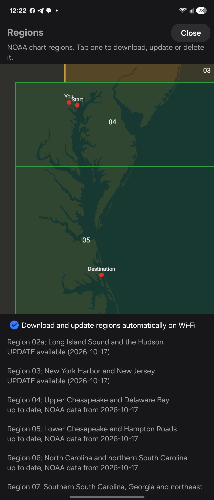
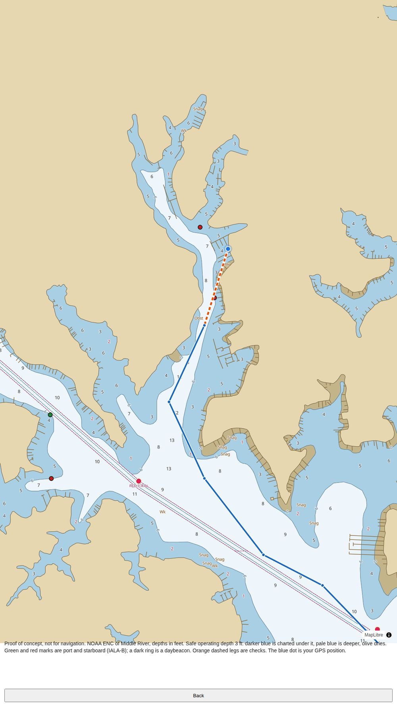
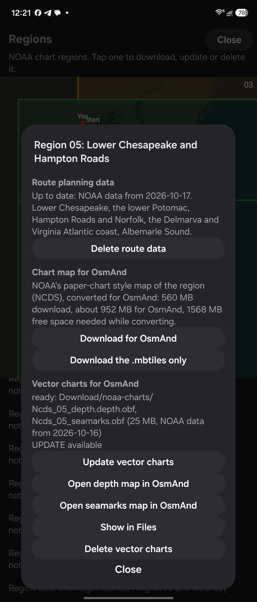
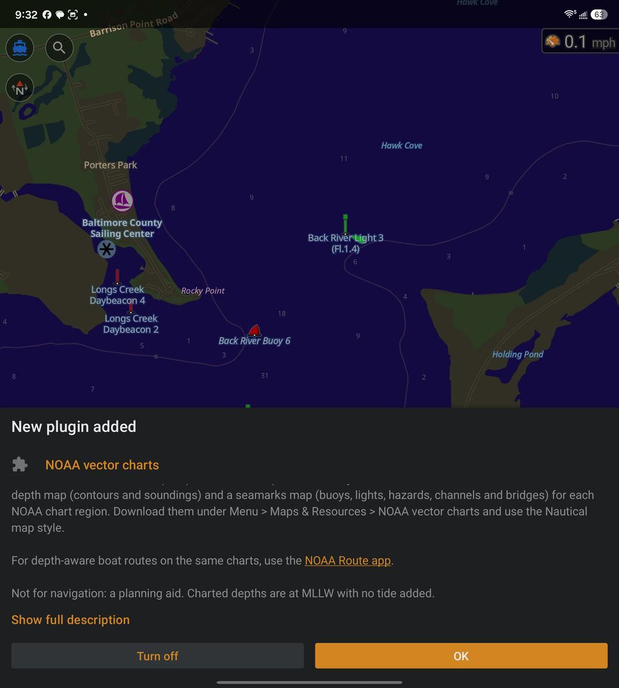
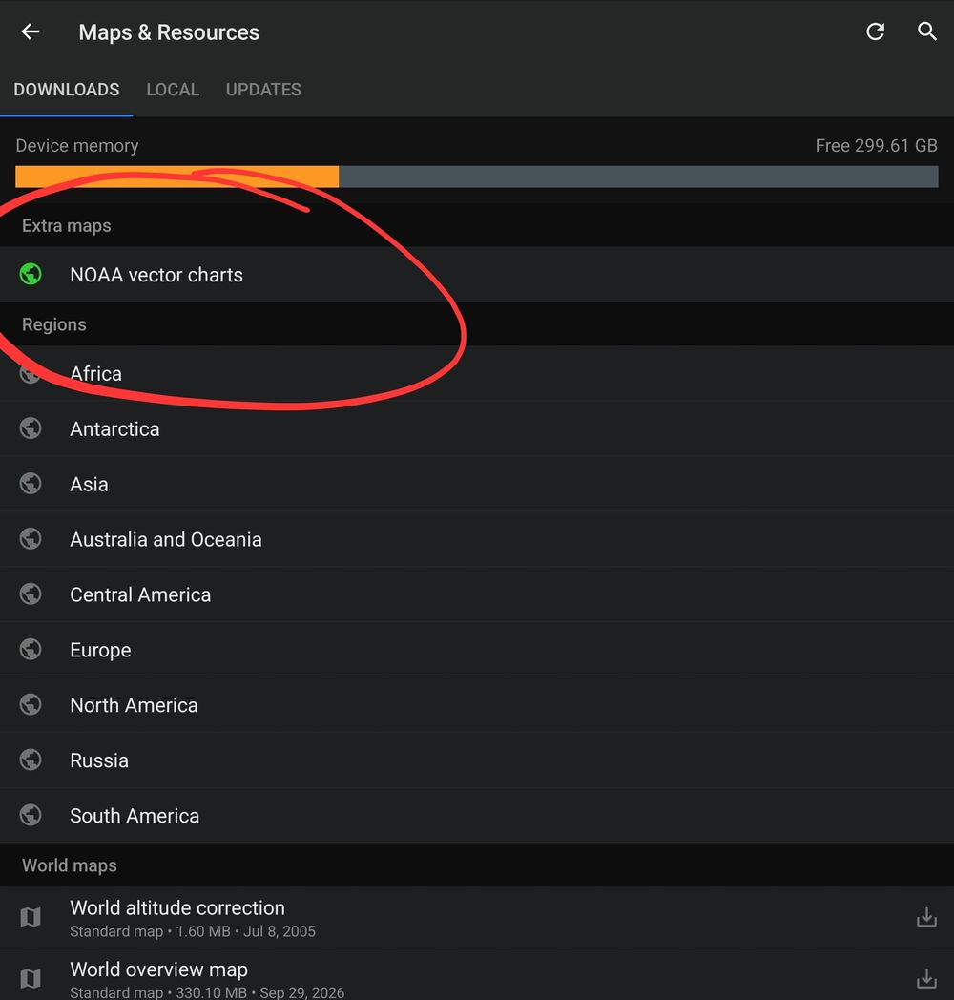
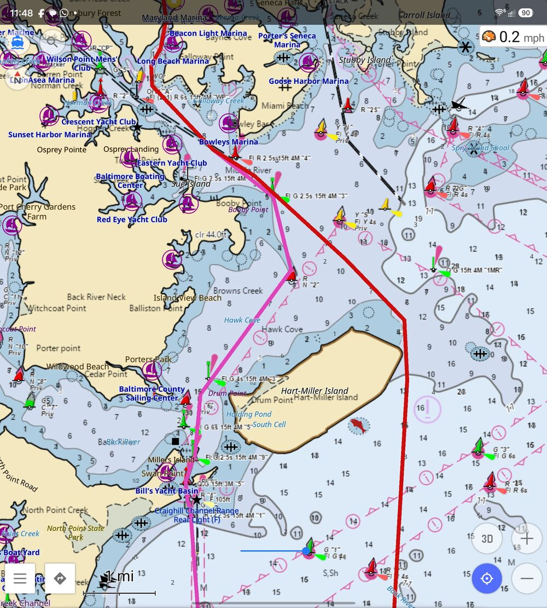
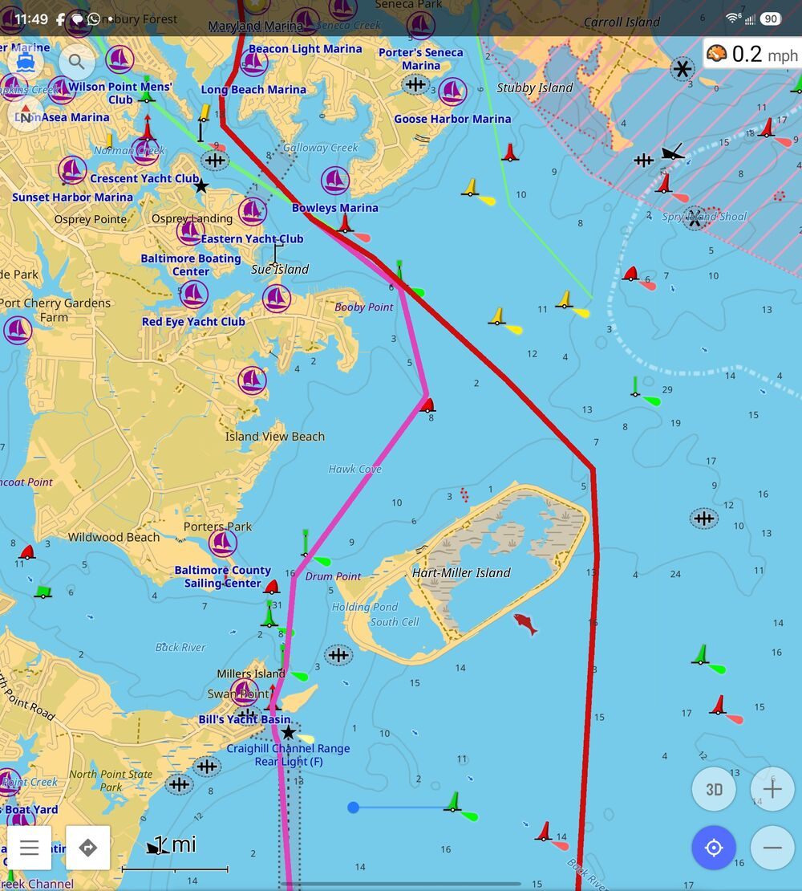
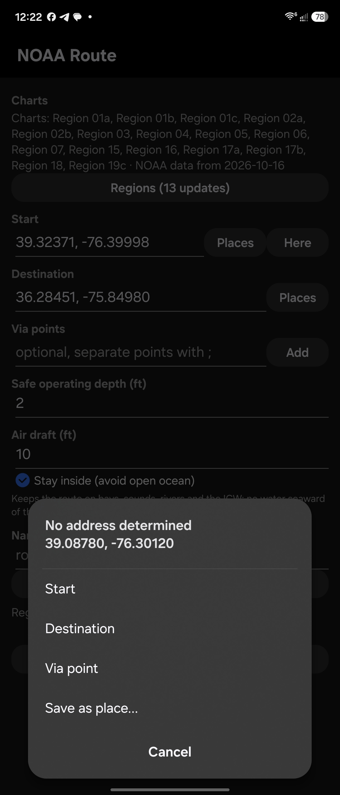

# NOAA Route: offline boat route planning for Android

**NOAA Route** is an Android app that plans water routes for your boat from NOAA's official vector charts (ENC). You enter a start, a destination, your safe operating depth and air draft. It plans a route that stays in deep enough water, keeps off shoals, rocks and wrecks, passes channel markers on the correct side and only goes under bridges with enough clearance. Then it sends the route to OsmAnd+ as a GPX file. Once you have downloaded your chart region, the app plans fully offline, usually in under a second. Termux is not needed.

The app can also download NOAA's paper-chart style maps and convert them for OsmAnd+, so you get charts and routes from one place.

**[Download the app (noaa-route.apk)](https://github.com/jnyer27/noaa-osmand-charts/releases/tag/app)**

<p>
  
  
</p>

*Left: Maryland Marina to North Carolina inside (Stay inside on), 417.6 nm, planned offline in 54 s at a 5 ft safe operating depth. Right: the Regions screen.*

> **Not a certified navigation system.** NOAA Route is a planning aid. Charted depths are at MLLW with no tide added, soundings are sparse, and the bottom changes. Check every leg against a current chart before you run it, and keep your eyes on the water.

**[User guide](https://jnyer27.github.io/noaa-osmand-charts/)**: installing, planning, reading the route report, OsmAnd, regions, safety and troubleshooting. What changed in each release: [CHANGELOG.md](CHANGELOG.md).

The project began as a set of Termux scripts, which are kept in this repository as the [proof of concept](#proof-of-concept-the-termux-scripts) that the app grew from.

---

## Install

1. Download `noaa-route.apk` from the [app release](https://github.com/jnyer27/noaa-osmand-charts/releases/tag/app) on your phone and open it. Allow installs from your browser or file manager when Android asks.
2. Later builds install over it as updates.
3. To view routes and charts on a map, install **OsmAnd+** and see [Using routes and charts in OsmAnd+](#using-routes-and-charts-in-osmand).

## Quick start

1. **First launch:** the app asks **Where do you boat?**. It finds your chart region from your location, or you can pick the region on the map. It then downloads that region (usually 2-7 MB; the largest, Arctic Alaska, is 14 MB).
2. **Start and Destination:** type or paste `LAT, LON` (or `39.25 N, 76.48 W`), pick from **Places**, tap **Here** for your GPS position, or share a spot from OsmAnd or Google Maps (**Share > NOAA Route**; a Google Maps link needs the internet to read).
3. **Safe operating depth (ft):** the shallowest charted depth you are willing to use, which is your draft plus a margin. For example, a boat with a 1.8 ft draft might use 3 ft. Add your **Air draft (ft)** to avoid low bridges and cables. Check **Stay inside (avoid open ocean)** to keep the route on bays, sounds, rivers and the ICW. Check **Move ends to navigable water** if your dock or anchorage is in water too shallow for your safe depth: the route then starts at the nearest water charted at least that deep, and the leg from your point is marked to check.
4. Tap **Plan route**. You get a leg-by-leg report (course, distance and notes on anything that needs a look) and a GPX file in `Download/noaa-charts/routes/`.
5. **Check the route before you go.** Every route needs checking. Where the planner cannot keep to water charted at least your safe operating depth (a creek, a marina entrance, a narrow channel), it goes on and flags the leg instead of stopping: a flagged leg is one it could not prove safe. Look at each leg with a note on a current chart:
   - **shallow water**: "N m where charted depth may be under 5 ft" (your own safe depth in place of 5 ft): check the tide and the shallowest sounding named with it,
   - **"check" notes**: a hazard the leg passes close to (named, with its depth and distance), a channel marker passed on the wrong side, piers or seawalls, piles or snags,
   - **"connects your point to usable water"**: the legs at either end, which are not checked at all,
   - **bridges and cables**: clearances and opening schedules,
   - **restricted areas**: their rules.

   [What each note means](https://jnyer27.github.io/noaa-osmand-charts/report.html#what-each-note-means) explains every note and what to do. With **Check markers in the GPX** on, each stretch of flagged legs has an orange start and a green end marker in OsmAnd, which announces them as you approach.

   **Try to avoid checks**, under the report, replans each flagged stretch around its causes and keeps the change only when the checks are gone and the detour is small (at most 0.2 nm or 10% of the stretch). Anything it changes is saved as `<name>_adjusted.gpx`; the original stays as it was, and the adjusted route still needs checking.
6. Tap **Open in OsmAnd** to follow the route. Underway, follow the buoys rather than the line and watch the depth sounder where the report flags shallow water. **View on map** draws the same route on a chart of Middle River inside the app (a proof of concept for that area, offline). OsmAnd is still how you follow a route anywhere else.

<p>
  
</p>

*The main screen before planning: installed regions, the trip, Safe operating depth (5 ft here), air draft, Stay inside and Check markers in the GPX.*

## Features

- **Depth-aware routing.** Routes stay on water charted at your safe operating depth wherever possible. Shallow stretches are flagged with their length and the shallowest nearby sounding. If no route exists, the app explains why: it names the limiting sounding or obstruction and its position, and gives the deepest depth setting that does work.
- **Channel-aware routing.** Dredged channels are preferred, and so are charted fairways and recommended tracks where the ICW is charted only that way. Lateral buoys and daybeacons are never passed on the wrong side, so "red right returning" holds in both directions.
- **Move ends to navigable water.** An option moves a start or destination in water charted under your safe depth, or one your boat cannot get out of (a dock up a 0-6 ft creek, behind a low bridge), to the nearest water within 0.5 nm charted at least that deep that leads on, and marks the leg to your point as a check.
- **Stay inside.** An option keeps routes off the open ocean, for example down the Chesapeake and Pamlico Sound instead of outside the Outer Banks. Without it, the planner takes the shortest charted water, which can mean a long ocean run past capes like Hatteras.
- **Bridges and cables.** Routes go only under navigation spans with a charted clearance, and only when that clearance covers your air draft. Opening bridges are reported with their closed clearance.
- **Long trips.** Trips of 100+ nm (for example, the Chesapeake down the ICW to the Carolinas) are planned at 20 m detail end to end in seconds, and can cross between chart regions.
- **Via points and places.** Add via points in order. Save and edit favorite spots under **Manage places** (**+ Add a place**, tap a place to edit or delete it; saving under an existing name updates it). The list starts with six sample Chesapeake places, which you can edit or delete.
- **Works with OsmAnd.** You can share a position from OsmAnd into the app (tap a spot, then **Share > NOAA Route**). Map links, `geo:` links, plain coordinates and GPX files also work, and so does **Share** from Google Maps: the app follows Google's short link (this needs the internet) and reads the place's pin. A dialog titled with the shared spot's name and coordinates ("No address determined" from OsmAnd for a spot without an address) asks whether it is the **Start**, **Destination**, a **Via point**, or should be **saved as a place**; when several positions are shared, it first asks **Which position?**. For a GPX file, you can pick a waypoint, use a route or track's first and last points as the trip, or save all its waypoints as places.
- **Weekly NOAA data.** Route data is rebuilt every week from NOAA's current charts, with Notices to Mariners corrections applied. The app can update your regions automatically on Wi-Fi.
- **Chart maps for OsmAnd.** The app downloads NOAA's paper-chart style maps, converts them for OsmAnd and can combine several regions into one map.
- **Vector charts for OsmAnd.** NOAA's vector charts as OsmAnd maps that OsmAnd draws itself: depth contours and soundings, buoys and beacons in their real colors and shapes, lights, wrecks, obstructions, channels and bridges. Rebuilt weekly with Notices to Mariners corrections, sharp at every zoom and only tens of MB per region. Import them from the app, or get the OsmAnd plugin and let OsmAnd download them.
- **View on map (proof of concept).** After planning, the app can draw the route itself on NOAA's ENC chart of Middle River, MD: depth shading for your safe operating depth, soundings in feet, buoys and daybeacons in their colors, lights and bridges, with legs to check in orange, and your GPS position. The chart is bundled and offline. It covers Middle River only. Plan route, the GPX file and Open in OsmAnd are unchanged.

<p>
  
</p>

*View on map, proof of concept, safe operating depth 3 ft. Soundings under 3 ft are red. The orange dashed leg is a check. The blue dot is the GPS position.*
- **Fully offline once a region is downloaded.**

## Chart regions

Route data comes in NOAA Chart Display Service regions. These are the same numbered regions as NOAA's chart maps (`ncds_04`, `ncds_05`). Every region with harbor or approach charts is available, from Maine to Texas, the Great Lakes, the West Coast, Alaska, Hawaii, Puerto Rico and the Virgin Islands, and the Pacific islands. Region 21, open ocean off British Columbia, has none:

| Region | Covers | Size |
|---|---|---|
| **01a** | The New Hampshire and Maine coast from Portsmouth to Casco Bay and Boothbay, Lake Champlain, eastern Lake Ontario (Oswego, Sackets Harbor) and the St. Lawrence through the Thousand Islands | 2.3 MB |
| **01b** | Rockland, Camden and Penobscot Bay, Blue Hill Bay, Mount Desert Island and Bar Harbor, Frenchman Bay, Jonesport and Machias Bay | 1.2 MB |
| **01c** | Eastport, Lubec, Cobscook Bay and Passamaquoddy Bay on the Canadian border | 0.2 MB |
| **02a** | Long Island Sound north of 41.1 N and its east end, the Hudson from Haverstraw to Troy, Connecticut and Rhode Island, Narragansett Bay | 4.8 MB |
| **02b** | Buzzards Bay, Martha's Vineyard and Nantucket, the Cape Cod Canal, Cape Cod Bay, Boston Harbor and Massachusetts Bay | 2.0 MB |
| **03** | New York Harbor and the lower Hudson, western Long Island Sound, Long Island's south shore, northern NJ, the Delaware River from Wilmington to Trenton | 6.7 MB |
| **04** | Upper and mid Chesapeake, the Potomac to Washington, the C&D Canal, Delaware Bay, the NJ coast from Cape May to Barnegat | 4.4 MB |
| **05** | Lower Chesapeake, Hampton Roads, the Virginia coast, Albemarle Sound | 4.2 MB |
| **06** | Pamlico Sound and Hatteras, Beaufort and Morehead City, Wilmington, Myrtle Beach, Charleston, the Savannah River to Augusta | 3.6 MB |
| **07** | Beaufort SC and Hilton Head, Savannah, the Georgia sea islands, Jacksonville and the St. Johns, the Florida coast to Cape Canaveral | 4.6 MB |
| **08** | The Indian River south of Cape Canaveral, the Atlantic coast and ICW from Sebastian to Miami, Biscayne Bay, the upper Keys | 3.0 MB |
| **09** | Puerto Rico (San Juan, Fajardo, Ponce), Vieques and Culebra, and the US Virgin Islands (St. Thomas, St. John, St. Croix) | 4.3 MB |
| **10** | Tampa Bay, Sarasota, Charlotte Harbor, Fort Myers, Naples, Florida Bay, the Keys from Islamorada to Key West and the Dry Tortugas | 4.6 MB |
| **11** | The Gulf coast from Tarpon Springs and the Big Bend to Apalachicola, Panama City, Pensacola, Mobile Bay and Mississippi Sound to Biloxi | 4.4 MB |
| **12** | The Mississippi River from Baton Rouge past New Orleans, Lake Pontchartrain and Lake Borgne, western Mississippi Sound (Gulfport), Morgan City and the Intracoastal Waterway across Louisiana | 3.3 MB |
| **13** | Louisiana's coast south of 29.33 N: the Mississippi River below Venice and its passes, Barataria Bay and Grand Isle, Terrebonne and Timbalier Bays, and Atchafalaya Bay | 1.4 MB |
| **14** | Lake Charles and the Calcasieu, Sabine Pass, Galveston Bay and the Houston Ship Channel, Freeport, Matagorda Bay, Corpus Christi, and the Laguna Madre to Brownsville | 4.8 MB |
| **15** | Lake Erie from Toledo and the Bass Islands to Cleveland, Erie and Dunkirk, the Detroit River and Lake St. Clair | 1.7 MB |
| **16** | Lake Ontario's US shore from Niagara to Sodus Bay, Buffalo and the Niagara River, the St. Clair River, and Lake Huron's Michigan shore from Port Huron and Saginaw Bay to Alpena and Drummond Island | 2.3 MB |
| **17a** | Green Bay and Door County, Grand Traverse Bay, Charlevoix, Petoskey, Mackinac Island, Cheboygan and the Straits of Mackinac, and Lake Michigan's shores north of Ludington and Manitowoc | 2.2 MB |
| **17b** | Chicago, Milwaukee, Sheboygan, Michigan City, St. Joseph, Holland, Grand Haven and Muskegon | 1.3 MB |
| **18** | Lake Superior's US shore: Duluth and Two Harbors, the Apostle Islands, Isle Royale, Marquette, Munising, Whitefish Bay, and the St. Marys River at Sault Ste. Marie | 2.7 MB |
| **19a** | San Diego Bay, Mission Bay, Oceanside, Dana Point, Newport Beach, Long Beach and Los Angeles harbors, and Catalina Island | 1.6 MB |
| **19b** | Santa Monica Bay and Marina del Rey, the Channel Islands, Ventura, Santa Barbara, Morro Bay and Monterey Bay | 2.1 MB |
| **19c** | San Francisco Bay, San Pablo Bay, the Sacramento-San Joaquin Delta to Sacramento and Stockton, and the coast from Half Moon Bay to Bodega Bay | 3.9 MB |
| **19d** | Offshore waters west of San Francisco Bay: the Farallon Islands, Cordell Bank and Bodega Canyon | 0.3 MB |
| **20a** | Fort Bragg, Humboldt Bay and Eureka, Crescent City, Brookings, Coos Bay, Florence and Newport (Yaquina Bay) | 1.5 MB |
| **20b** | The Columbia River from the bar to Portland and the Willamette, Tillamook Bay, Willapa Bay and Grays Harbor | 1.9 MB |
| **20c** | Puget Sound from Olympia to Seattle and Everett, Hood Canal, the Strait of Juan de Fuca, the San Juan Islands, Bellingham, and the Washington coast north of Grays Harbor | 5.8 MB |
| **22a** | Ketchikan and Tongass Narrows, Metlakatla, Prince of Wales Island (Craig), Clarence Strait and Dixon Entrance | 2.3 MB |
| **22b** | Wrangell, Wrangell Narrows, Petersburg and Sumner Strait | 2.1 MB |
| **23a** | Sitka and Sitka Sound, the outer coasts of Baranof and Chichagof Islands, Chatham Strait, Kake and Frederick Sound | 1.5 MB |
| **23b** | Juneau and Auke Bay, Stephens Passage, Icy Strait, Glacier Bay, Lynn Canal to Haines and Skagway, and Yakutat | 1.6 MB |
| **24a** | Prince William Sound (Valdez, Cordova, Whittier), the Copper River delta, and the coast east to Yakutat Bay | 6.7 MB |
| **24b** | Seward and Resurrection Bay, Kenai Fjords, Cook Inlet (Homer, Seldovia, Anchorage), and Kodiak | 4.0 MB |
| **25a** | Shelikof Strait, the Alaska Peninsula's Pacific coast to Chignik, and eastern Bristol Bay (Naknek, Dillingham) | 6.2 MB |
| **25b** | The Shumagin Islands and Sand Point, King Cove, Cold Bay, False Pass and western Bristol Bay | 8.7 MB |
| **26a** | Dutch Harbor and Unalaska, Akutan, Umnak and the Islands of Four Mountains, and the Pribilof Islands | 7.3 MB |
| **26b** | Adak, Atka and the Andreanof Islands | 2.4 MB |
| **27** | Norton Sound and Nome, the Yukon delta, Bering Strait, Kotzebue Sound, and the Arctic coast to Utqiagvik and Prudhoe Bay | 13.7 MB |
| **28a** | Nihoa, Necker, French Frigate Shoals, Gardner Pinnacles, Midway and Johnston Atoll | 4.8 MB |
| **28b** | Oahu and Honolulu, Maui, Lanai, Molokai, the Big Island (Hilo, Kona) and Kauai | 5.8 MB |
| **29** | Tutuila (Pago Pago), the Manu'a Islands, Swains Island, Rose Atoll, Palmyra, Kingman Reef, Jarvis, Howland and Baker Islands | 3.1 MB |
| **30** | The Rat and Near Islands: Kiska, Shemya and Attu | 5.1 MB |
| **31a** | Guam (Apra Harbor), Rota, Tinian and Saipan, and the northern Marianas | 9.5 MB |
| **31b** | Pohnpei, Kosrae and other islands of the Federated States of Micronesia, and Wake Island | 10.4 MB |

Region 15 (Lake Erie) depths are charted to the Great Lakes Low Water Datum, not MLLW, and the route report and GPX say so. Lake levels are usually above that datum, but they change with the season and with wind.

- **Regions screen:** tap **Regions** for a map of NOAA's regions on a built-in coastline that works offline. Green means downloaded and up to date, amber means an update is available, dashed blue means available, and faint gray means no route data yet. Red dots mark your trip's **Start** and **Destination** and your last known position (**You**), and "chart map" under a region's number means its chart map for OsmAnd is ready. The map opens zoomed to the trip, else to your regions. Tap a region (or its row in the list below) to open its card, with three parts: **Route planning data** (download, update or delete), **Chart map for OsmAnd** (sizes before download; download for OsmAnd or .mbtiles only; while downloading, **Cancel download**; when ready, **Open in OsmAnd**, **Show in Files**, **Add to combined map**, **Delete chart map**; if it failed, **Try again** or **Remove**) and **Vector charts for OsmAnd** (download, update, open the depth and seamarks maps in OsmAnd, **Show in Files**, delete). Pinch to zoom, drag to pan and double-tap to zoom in. The list shows each region's status (not downloaded with its size, UPDATE available, or up to date with the NOAA data date), then your chart maps and vector charts. The main screen shows how old your data is ("Charts: Region 04, Region 05 · NOAA data from ..."), how many updates are waiting (**Regions (13 updates)**), and download progress in the status line ("Downloading Region 06: 1.2 of 3.6 MB", then "Region 06 ready."). The [user guide](https://jnyer27.github.io/noaa-osmand-charts/regions.html) has screenshots of the Regions screen and a region card.
<p>
  
  
</p>

*Left: the Regions screen with the trip's Start and Destination. Right: a region card with its route data, chart map and vector charts.*

- **Trips that need another region:** once Start and Destination are filled in, a banner above **Plan route** names any region the trip runs into that is not downloaded, with its size and a **Download** button. The banner also says when part of the trip is outside every region.
- **Automatic downloads:** the first time you download a region, the app asks once whether to download and update regions automatically on Wi-Fi. You can change this on the Regions screen. If you say yes, a daily background job fetches NOAA's weekly rebuild of your regions on Wi-Fi only, and a trip that needs another region gets it without asking. On mobile data the app still asks first.
- **Moving from Chesapeake Bay:** regions 04 and 05 replace the older **Chesapeake Bay** area. The app offers the switch, or makes it on its own on Wi-Fi if automatic downloads are on, and removes the old area once both regions are in. The Chesapeake Bay area is no longer published. App versions from before regions existed can download regions 04 and 05 from their list.

## Chart maps for OsmAnd

Tap any NOAA region on the Regions map to open its card. Besides the route data, the card offers NOAA's paper-chart style map of the region (NCDS):

- **Download for OsmAnd** downloads the map with Android's download manager. You can choose Wi-Fi only or allow mobile data. The download resumes after interruptions and keeps going with the app closed. The app then converts the map to OsmAnd's format as `Download/noaa-charts/ncds_XX.sqlitedb`.
- **Download the .mbtiles only** keeps NOAA's file as it is, for OpenCPN or other apps.
- A converted map is about 1.7 times the size of NOAA's file, and converting needs about 2.8 times that size in free space. The app checks the space first. Ready maps open in OsmAnd or Files.
- **Combine chart maps for OsmAnd:** OsmAnd shows one chart overlay at a time, so this merges two or more regions into one map (`ncds_04_05.sqlitedb`). Where regions overlap, the more detailed tile wins. A combined map's card can **Add regions** later: the new region is merged into the combined file in place and the file is renamed (`ncds_04_05_06.sqlitedb`). After that, the region's own map can be deleted.
- OsmAnd keeps its own copy of an imported map. After adding regions, delete the old map in OsmAnd and import the new file. The app cannot amend combined maps that were made in Termux, because Android does not let one app open another app's files.

### Vector charts for OsmAnd

The region card also offers NOAA's vector charts (ENC) as two OsmAnd maps per region, built every week from the current charts with Notices to Mariners corrections:

- **Depth map** (`Ncds_XX_depth.depth.obf`): depth contours, depth areas and soundings. OsmAnd lists it under **Nautical maps**, and it follows the Nautical depth switch. Soundings thin out as you zoom out, like a chart of that scale: coastal charts' soundings from zoom 11, approach charts' from 13 and harbor charts' from 15.
- **Seamarks map** (`Ncds_XX_seamarks.obf`): buoys and beacons, lights, wrecks, rocks and obstructions, piers, bridges, overhead cables, fairways and dredged channels (drawn as named green fairways), and restricted, anchorage and cable areas. OsmAnd lists it under **Standard maps**, so you can deactivate it on its own.
- **Download vector charts** fetches both with Android's download manager (Wi-Fi only or mobile data too), checks them and saves them to `Download/noaa-charts`. Tap the "ready" notice or open the region card, then **Open depth map in OsmAnd** and **Open seamarks map in OsmAnd** to import them. An **Update** button appears when a newer weekly build is out: delete the old maps in OsmAnd (Maps & Resources > Local) and open the new ones.
- **Get the OsmAnd plugin** (at the top of the Regions screen and on the region card) is the other way: it opens `noaa-charts.osf` in OsmAnd, which adds the **NOAA vector charts** plugin. OsmAnd then lists every region under **Extra maps** in Menu > Maps & Resources and downloads its maps itself, from the same weekly builds (the plugin reads its list from each build). Use one way or the other for a region, not both.

<p>
  
  
</p>

*The OsmAnd plugin. Left: OsmAnd adding it. Right: its regions under Extra maps in Maps & Resources.*
- Use the Nautical map style. Depth labels are in whole feet. Seamarks that OpenStreetMap volunteers mapped also come with OsmAnd's own maps, so some buoys show twice. Daymarks and light sectors are not drawn yet.
- OsmAnd's current release (5.4) draws only its standard contour classes, so NOAA's shallow contours (3, 6, 12 and 18 ft) all draw alike (each labeled with its depth) and depth areas are not shaded. OsmAnd's development version adds new depth rules: shallow (2 m) contours drawn dashed, darker contour lines and depth area shading ([OsmAnd-resources #1478](https://github.com/osmandapp/OsmAnd-resources/pull/1478), [depth areas](https://github.com/osmandapp/OsmAnd-resources/commit/09f91397c78435e67f66676351ebef9b699f1340)). The depth maps already carry the depth area tags, so shading and the darker lines will appear once an OsmAnd release includes the new rules. The shallow contours are written in the 5 m class for now so that today's OsmAnd draws them; after that release, the weekly build will write them in the new 2 m class.

<p>
  
  
</p>

*The same spot in OsmAnd, both made by the app. Left: the chart map (NOAA's paper chart as an overlay). Right: the vector charts (depth and seamarks maps drawn by OsmAnd).*

## How the planner decides where you can go

| Charted | Treatment |
|---|---|
| Depth area at least your depth (usually the 6 ft+ areas) | Used freely |
| Depth area spanning your depth (NOAA's usual 0-6 ft band) | Used only when needed. Soundings shallower than your depth are hazards. Legs through this band are flagged with the length in it and the shallowest charted sounding within 100 m |
| Land, drying, unsurveyed or uncharted water | Never used |
| Rocks, wrecks and obstructions shallower than your depth + 1 ft or of unknown depth, and soundings shallower than your depth | Avoided with a 60 m hazard buffer. Over water charted at least your depth (such as a dredged channel), only the hazard itself is a wall, and the buffer is used only where there is no other way. Such legs are flagged "passes near charted shoal soundings or obstructions: check". In water that may be shallower than your depth, the whole buffer is a wall. Foul ground (safe to navigate over, bad for anchoring) only counts if it has a charted depth that is too shallow |
| Dredged channels and charted fairways at least your depth | Preferred. Being near the edge of a maintained channel is normal, so the keep-off-the-shore cost there is a quarter of the usual, and shoal soundings on a channel's banks cost far less. As a result, long trips take the ICW or the C&D Canal instead of going outside. Charted fairways count as channels because stretches of the ICW (along Oak Island, for example) are charted only as a fairway, with no dredged area. So do cells on a charted recommended track, deep enough for you and more than 200 m from any charted fairway or dredged area: in Bogue Sound the ICW is charted only as a track |
| Channel markers (lateral buoys and daybeacons) | Never passed on the wrong side. Each mark gets a line from 20 m to 100 m out, pointing away from its channel: away from the nearest charted fairway, dredged area or recommended track (such as the ICW's), or else away from the nearest opposite-color mark. The mark's own grid cell stays open, because a channel charted only one 20 m cell wide can have its buoys in that cell. This keeps both "red right returning" and "green right going out" whichever way you go. Routes cross such a line only when there is no other way, flagged "passes over or on the wrong side of a channel marker: check". The lines never run through a charted fairway or dredged area. A mark with no channel or partner nearby gets no line, and neither do junction (preferred channel) marks |
| Submerged snags and piles of unknown depth (old pilings) | In water charted at least your depth, crossed only when there is no other way, flagged "passes charted piles or snags: check". An example is the piles charted at the edge of a narrow dredged channel, such as Adams Creek Canal on the ICW. Elsewhere, a wall with the buffer |
| Bridge piers and piers drawn as areas | Avoided, without the buffer (they are visible). Obstructions, wrecks and rocks of unknown depth charted within about 20 m of a bridge (a swing span's pivot, fenders) count as bridge structure too. Ruined bridges are not walls |
| Bridges over a dredged channel | The route takes the channel span. Water under the same bridge outside the dredged channel costs as much as crossing a pier line, because that is where the piers are and they are often not charted (the Jordan Bridge is charted as one 145 ft polygon). A side span is used only when it is the only way |
| Piers, seawalls, jetties and breakwaters charted as lines (shoreline construction) | Crossed only when there is no other way, for example into a slip. They cost 50 times as much as normal water and count as shore for the keep-off cost. Legs that run along or across one are flagged "runs along or across charted piers or seawalls: check". Exception: where such a line falls in a dredged channel under a bridge span you clear, it is taken as the span's fender and the channel cell stays open, so the route goes through the channel span (on the 20 m grid the fenders of a narrow span otherwise filled the channel) |
| Single charted piles | Not avoided, because a 20 m grid cell would close narrow channels. Keep a lookout |
| Bridges | Passed only under spans with a charted clearance (the navigation spans), and only if that clearance covers your air draft. Opening bridges (swing, bascule, lift, draw) are passed and reported with their closed clearance. Check the opening schedule. Overhead cables charted with only a safe clearance (common for power lines) use that clearance. On the 20 m grid, the line through a narrow opening can run along one side of it instead of down the middle (for example right by the rest pier of the Amtrak swing bridge over the Bush River), so line up on the opening by eye |
| Entry prohibited | Never used |
| Coast Guard security zones (33 CFR 165) | Used, but every leg through one is a check, with check markers in the GPX: "Cove Point Liquefied Natural Gas Terminal Security Zone: security zone, entry may be prohibited: check (33 CFR 165.502)". Some are always closed (the Cove Point LNG terminal, nuclear plants, Navy bases), others only around particular vessels or when the Coast Guard announces them, and the charts do not tell them apart, so the planner never blocks one: read the regulation and the Local Notice to Mariners, and plan around it if it applies. NOAA charts many of them with only the regulation's number; the weekly build reads the current list of security zone regulations from eCFR (`tools/security_zones.py`), so new zones are caught as soon as NOAA charts them. Temporary zones announced only in the Local Notice to Mariners are not charted and not known to the app |
| Open ocean, with **Stay inside** checked | Never used. Open ocean is the water reached from 12 nm offshore (NOAA's contiguous zone and EEZ) without crossing land or a COLREGS demarcation line (the lines across inlets and bay mouths, 33 CFR 80), with openings narrower than 600 m sealed and only water charted 6 ft or deeper flooded, then grown back 300 m to the beach. So the Chesapeake, Delaware Bay, Albemarle and Pamlico Sounds are inside, and the ocean along the beaches is not. If a point is out there, the planner says "open ocean (Stay inside is on)". For example, Maryland Marina to the Neuse with Stay inside is 300 nm through the ICW's Virginia Cut and the sounds, instead of 311 nm outside past Cape Hatteras. A region whose data does not reach 12 nm offshore has no open ocean, and on the Great Lakes everything is inside |
| Areas to be avoided | Used, but reported. On US charts these are IMO routing measures for large ships (the Aleutian ones apply to ships of 400 gross tons and up and surround Adak, Dutch Harbor and Sand Point) |
| Other restricted areas (entry restricted, no wake, anchoring) | Used, but reported with the CFR rule |

Routes keep off the shore. The cost of a cell rises within about 100 m of land, shallow water, piers, structures and hazard buffers, up to 3.4 times next to them, so the route only goes close where it has to. A second, gentler rise (up to 1.3 times) reaches 300 m out, so between shoals or in a gap under 600 m wide the route keeps toward the middle instead of running along the edge of the 100 m zone. Both rises are damped inside dredged channels. In 0-6 ft water, the 40 m next to land, drying ground or a hazard buffer costs 10 times more again, because such water shoals toward the bank: the route reaches a creek or slip that way when it must, but does not take a narrow gut as a shortcut. The exception is 0-6 ft water inside a charted dredged area or fairway, which is a shoaled stretch of the channel, not a gut (south of Masonboro Inlet the ICW's dredged area is charted shallower for a few cells). 0-6 ft water beside a narrow channel keeps the 10 times cost, so the route does not step out of the channel and back. Where a channel one grid cell wide runs diagonally past a land or pier corner (the ICW's Coinjock cut and its bridge), the route may step diagonally from one channel cell to the next, and straight legs may follow it. On the coarse overview of a long trip, 0-6 ft water next to a channel also skips the 10 times cost, so a narrow channel that breaks up there still guides the trip. When the route is straightened into long legs, no leg is moved into the two grid cells nearest danger unless the planned path itself went there, no leg crosses more piers or seawalls than the path did, and no leg runs a larger share of its length through 0-6 ft water or hazard buffers than the path did. Where long trips join planned stretches at guide points, small overshoots of a cell or two are trimmed. After the whole trip is planned, the route is planned again at full detail for 2 km either side of each guide point, and that version is kept if it is cheaper and shorter: a guide point marks where the coarse overview passed, not always the best line (leaving Snows Cut, one drew a 200 m run up the Cape Fear River and back). Inside marinas and narrow bulkheaded harbors (such as Ego Alley), the route still runs close to piers and walls, because there is no other water. In a narrow canal, where usable water on the 20 m grid is only a thin diagonal band, a second pass joins the grid's one-cell staircase steps into straight legs that stay within one cell (20 m) of the planned path. Those legs may graze the edge of the 0-6 ft water or a hazard buffer beside the channel, never land, a hazard, a pier, too-shallow water or a low bridge; in a lock between charted walls the steps stay.

Depth areas are sampled at the center of each 20 m cell. Where a deeper area is thinner than a cell and breaks into separate cells, a gap of up to two cells that the area touches gets its depth, so a thin charted channel stays joined (the ICW's 6-12 ft strip at Bogue Sound buoy 11A, between 1 ft and 3.3 ft soundings). Depths are compared with 5 cm of slack, because NOAA stores feet rounded to 0.1 m (the 6 ft line is 1.8 m, or 5.9 ft). NOAA's depth areas usually step 0 / 6 / 12 ft, so at a 3 ft depth setting most creeks fall in the flagged 0-6 ft band. The planner keeps those stretches as short as it can.

A point on land or a dock is moved to the nearest usable water, and the report says how far. Sometimes that water is a pocket walled in only by land or structures, such as a marina basin behind a pier too thin for the grid. In that case the end moves up to 250 m to the nearest water that connects to the rest of the route, and the report says so. Either way, the route keeps that water as its own waypoint. The short leg between it and your point is marked "connects your point to usable water: not checked", because it may cross a dock or the shore, so steer it by eye.

If a point is boxed in by shallow water, land, a hazard buffer, or a bridge or cable too low for your air draft, the planner stops and says which one. It names the shallowest sounding or obstruction responsible, with its position, and when depth is the limit, it gives the deepest setting that gets out. For example, Maryland Marina at 6 ft is blocked by soundings as shallow as 3.9 ft, and 5 ft works.

With **Move ends to navigable water** checked, a point in water charted under your safe depth or in a hazard buffer (a marina in a 0-6 ft creek at 3 ft) is moved to the nearest water charted at least that deep and clear of hazard buffers, piers and markers, found along the water (not across a point of land) within 0.5 nm, so the route no longer starts with flagged shallow legs. A boxed-in point is not refused either: the route starts or ends at the nearest water within 0.5 nm that leads to the rest of the trip (or out of the area, when both ends are boxed in), whatever closes the pocket. The report says which point moved, how far and what closed it in, and the leg from your point to that water is marked "connects your point to usable water: not checked", a check with GPX check markers. That leg is a straight line across whatever is in between: shallow water, a hazard, a low bridge. Getting from your point to the moved end is up to you, by eye, on the tide. Only your own points move (via points too); points the planner places on long trips do not.

Long trips are worked out at 20 m detail within 20 km of each end first, to settle which inlet and which creek. The ends are then joined across open water on a coarse overview, and the route is planned at full 20 m detail stretch by stretch between guide points, about every 18 km on open water and every 8 km near the ends. An overview cell that holds a dredged channel or fairway counts as that channel (without the channel markers along it, and with no bridge when the channel water there has none over it, else with the bridge's highest span rather than its lowest), and the overview may step diagonally from one channel cell to the next, so a channel only one 20 m cell wide still shows on a 320 m overview. A guide point that turns out to be cut off at full detail (a pocket of water by an inlet, for example) is dropped, and the stretch heads for the next one.

## Safety and testing process

NOAA Route is a planning aid. These are the steps between NOAA's charts and a route on your phone, and what is left for you to check.

**What the report asks you to check.** Every leg that needs a look says why: the length where the charted depth may be under your safe depth and the shallowest sounding within 100 m (with "under your 5 ft" when it is shallower; the notes name your own **Safe operating depth**, 5 ft in these examples); "passes 25-45 m from a charted 3.2 ft sounding" (or obstruction, with its depth: the closest hazard whose buffer the leg uses, the distance as a 20 m grid cell range); "passes over or on the wrong side of a channel marker"; "runs along or across charted piers or seawalls"; "passes charted piles or snags"; opening bridges with their closed clearance; cables with their clearance; restricted areas with their CFR rule; and the short "connects your point to usable water: not checked" leg where a point was moved off land or a dock. None of these are errors, but each is a place to look at the chart and the water.

**How the shallow-water note is measured.** In "95 m where charted depth may be under 5 ft, shallowest sounding within 100 m 3.9 ft, under your 5 ft" (a route planned with a 5 ft **Safe operating depth**; your report shows your own), the length is an estimate: the leg's line is sampled about every 10 m on the 20 m grid, and the share of samples in a depth area whose range reaches below your safe depth is applied to the leg's length (a single sample is ignored). The sounding is the shallowest one charted within 100 m of any part of the leg, a strip along the leg rather than a circle around its route point, so on a long leg it can be anywhere along it:

```
        ╭───────────────────────────────╮   ↑
       (  WP09 ●━━━━━━━━━━━━━━━━━● WP10  )  100 m each side
        ╰───────────────────────────────╯   ↓
```

With **Check markers in the GPX** on (the default), the GPX also gets an orange waypoint where each stretch of legs to check starts and a green one where it ends, with the notes, for OsmAnd (which announces them during navigation when GPX waypoints are on in its voice prompts) and other chart apps. On or off, the route points of legs to check are named "check" (**WP09 check**); see the [user guide](https://jnyer27.github.io/noaa-osmand-charts/report.html#in-the-gpx-file).

<p>
  
  
</p>

*Check markers in OsmAnd. Left: the orange start and green end of a stretch to check (leg 10, 1.00 nm, in Middle River). Right: the start marker's notes, in the Check group. The route was planned with a 5 ft safe operating depth, so its notes say "under 5 ft".*

**What the planner does not know.** Depths are charted at MLLW (Low Water Datum on the Great Lakes) with no tide added. Soundings are sparse, the bottom moves, and single piles are not avoided. The grid is 20 m, so a line through a narrow opening may run along one side of it. Charts lag behind the water, even with Notices to Mariners corrections.

**How the route data is built.** Every week the route packs are rebuilt from NOAA's current ENC cells with all update files applied. The build checks each chart's depth units and records its sounding datum.

**Reference routes.** `tools/areas.json` holds over 100 reference routes. Some must come out within a length range. Some must be refused (a destination boxed in by shallow water, for example). Some must keep away from a spot: an inlet that should not be used, a drying patch, the wrong side of a buoy. Some must not break into a staircase of tiny legs, and some must stay inside. Every pack build and every planner change runs all of them through the app's own planner code, and nothing is published if one fails.

**Release steps.**
1. Every change is made on a branch.
2. Its packs go to the `route-pack-beta` pre-release, and the test APK built from the branch reads only those.
3. The change is tried on a phone.
4. After review it is merged into main, which builds the released app.
5. The tested beta packs are promoted to the `route-pack` release. Promotion is refused unless the commit they were tested from is in main.

**Problems you report.** A route that leaves the ICW, zig-zags or cuts a corner becomes a new reference route once fixed, so it cannot come back unnoticed. [CHANGELOG.md](CHANGELOG.md) lists the routing and safety changes in each release.

## Using routes and charts in OsmAnd+

NOAA Route does the work: it downloads NOAA's chart for your region, converts it to OsmAnd's format and hands it over, and it plans routes and sends them to OsmAnd as GPX. Both work fully offline once downloaded, so do the downloads at home on Wi-Fi.

1. **Get the chart.** In NOAA Route, tap **Regions**, tap your region, then **Download for OsmAnd**. The app downloads NOAA's chart, converts it and saves it as `Download/noaa-charts/ncds_XX.sqlitedb`. To show several regions at once, use **Combine chart maps for OsmAnd** to make one map from them.
2. **Add it to OsmAnd.** Tap **Open in OsmAnd** on the region card. OsmAnd imports the chart as an offline map. Then select it as the overlay in OsmAnd's map settings (OsmAnd's Online maps plugin must be on to draw it). If you use OsmAnd's Boat profile, set the overlay while that profile is active, since each profile keeps its own map settings.
3. **Send a route.** After planning, tap **Open in OsmAnd** to show and follow the route on the chart. If OsmAnd will not open it, tap **Show routes folder in Files** and tap the `.gpx` there.

<p>
  
</p>

*A spot shared from OsmAnd (tap the map, then Share > NOAA Route): use it as Start, Destination or a via point, or save it as a place.*

When NOAA publishes an update, download it again from the region card. OsmAnd keeps its own copy of an imported chart, so delete the old one in OsmAnd and import the new file.

### Reading the paper-chart (NCDS) style
- **Depths are in feet.**
- **A magenta teardrop is a light**, whatever its color. Read the color from the label: `Fl G 4s` is green, `Fl R 4s` is red.
- **A black dot with a height (for example, "15ft") is a fixed beacon on a pile**, not a buoy.
- Even numbers are red and odd numbers are green ("red right returning").

## FAQ

### Can it plan a trip from the Chesapeake to San Francisco through the Panama Canal?

No. NOAA Route only has charts for US waters, so its route data stops at the Florida Keys, Puerto Rico and the Virgin Islands, the Texas border and San Diego. Water with no chart data is never used, so the app warns that part of the trip is outside every region and refuses to plan it. The trip is also about 5,000 nm. The longest tested route is about 400 nm (Maryland Marina to Carolina Beach), so even with charts all the way it would be far beyond what the planner and a phone's memory are built for.

What works is planning each end on its own, for example the Chesapeake down the ICW to Florida and into the Gulf, and San Diego to San Francisco. Long open-water legs are where the planner adds least anyway: there it mostly draws a straight line, and its value is the careful routing near shore.

Covering a trip like this would need data that is mostly not public:

| Stretch | Data needed | Public? |
|---|---|---|
| US waters | NOAA ENCs | Yes, already used |
| Open ocean (Caribbean, Pacific off Mexico and Central America) | Depths and a coastline | Yes, at a coarse scale: [GEBCO](https://www.gebco.net/) global bathymetry (about 450 m grid) and an OpenStreetMap or GSHHG coastline |
| The Bahamas, Cuba, Colombia, Panama, Central America, Mexico | Each country's official ENCs (the same S-57 format NOAA uses) | No. They are sold through distributors (IC-ENC, PRIMAR) as encrypted S-63 cells, licensed per vessel, and may not be redistributed |
| The Panama Canal | Canal charts and transit rules | Not as free vector data. Transits are scheduled by the canal authority and taken with a pilot |
| Buoys, lights and harbor features abroad | Aids to navigation | Partly: [OpenSeaMap](https://www.openseamap.org/) is free, but its coverage is uneven and it has almost no depths |
| Foreign ports | Locations and basic facts | Yes: NGA's World Port Index and Sailing Directions |

So a version built on public data could, at most, route from a US harbor to a US harbor on a deep-water offshore track, leaving the foreign coast and the canal to you. Two things stand in the way of more:

- **Licensing.** Route data is published openly on GitHub, and licensed foreign ENCs cannot be redistributed that way. Routing into foreign harbors in the same detail as US ones would need each user's own chart licenses, decrypted and processed on the phone.
- **The pack format.** Packs are a 20 m grid, which is far too large for an ocean. Offshore legs would need a coarse grid (hundreds of meters per cell) that the planner joins to the detailed packs at each end.

### Could the chart maps come from NOAA's ECDIS service instead of NCDS, for more current charts?

For current charts, the app's [vector charts](#vector-charts-for-osmand) now do most of what ECDIS was wanted for: they are rebuilt every week from NOAA's ENCs with Notices to Mariners corrections, draw buoys and beacons in their real colors and shapes, and cover a whole region in tens of MB. ECDIS still adds the S-52 look (the SiiTech look), with daymarks and light sectors, which the vector charts do not draw yet. `noaa-ecdis-tiles.sh` builds OsmAnd maps from NOAA's ECDIS Display Service, and small-area ECDIS maps in the app are an open [feature request](https://github.com/jnyer27/noaa-osmand-charts/issues/1). The three sources trade off like this:

| | NCDS (pre-built regional MBTiles) | ECDIS (live display service, tile by tile) | Vector charts (`.obf` built from ENC) |
|---|---|---|---|
| How current | Whatever NOAA last packaged; can be stale (regions 04 and 05 were last published in May 2024) | NOAA's weekly Friday update, including Notice to Mariners corrections | Rebuilt weekly from NOAA's current ENCs, including Notice to Mariners corrections |
| Look | Paper chart; every light is a magenta teardrop, so read the label | S-52: true buoy and light colors, daymark shapes and light sectors | OsmAnd's Nautical style over OsmAnd's own land: buoys and beacons in their real colors and shapes; no daymarks or light sectors yet; some buoys show twice |
| Depths | Feet | Meters (a feet option exists but is unverified) | Feet (whole feet) |
| Area and zoom | Whole region, NOAA's fixed zoom levels | Any area, any zoom you choose | Whole region, sharp at every zoom |
| Size | About 600 MB per region (about 1.7 times that converted) | About 3-8 KB per tile: a zoom-16 map of Middle River was 12 MB | A depth map and a seamarks map: 22 MB for region 04, 25 MB for region 05 |
| Download | One file: resumable, background, light on NOAA | Thousands of live requests: about 31,000 tiles and several hours for the northern Chesapeake at zoom 16 | Two files from GitHub: resumable, background, no load on NOAA |
| Reliability | A normal file download | Long runs are fragile: connections hung after about 32,000 tiles, and Friday updates cause failed tiles (the script resumes and retries) | A normal file download |
| Refresh | Download the new file when NOAA publishes one | Every tile again; there is no "only what changed" | **Update** on the region card when a newer weekly build is out |
| In the app | Yes, including combining regions | Not yet (Termux script only) | Yes |

ECDIS is not practical for whole regions at high zoom: each zoom level is about four times as many tiles, and every user pulling millions of tiles would put real load on NOAA's server. Pre-rendering whole regions centrally each week would mean the same scraping plus multi-gigabyte files. So in the app:

- **Vector charts** for current charts over whole regions.
- **NCDS** for the paper-chart look, as an overlay.
- **ECDIS for small areas** (the water within about a mile of a planned route, or a box around your home waters, at zoom 15-16) remains a possible addition for the full S-52 look: a few hundred to a few thousand tiles, minutes rather than hours.

With the Termux scripts, the same pattern still applies: a wide NCDS underlay and a sharp, current ECDIS overlay for home waters.

### Could OsmAnd show vector ENC charts, like OpenCPN, instead of chart tiles?

Yes: see [Vector charts for OsmAnd](#vector-charts-for-osmand). This started as a [feature request](https://github.com/jnyer27/noaa-osmand-charts/issues/2), and the notes below are how it was weighed. OpenCPN reads NOAA's vector ENC cells directly and draws them itself, so its charts are current every week, sharp at every zoom, and shown in the units and detail you choose. OsmAnd cannot read ENCs, but it does draw its own vector maps (`.obf`), and its Marine map style (with the Nautical map view plugin) already renders OpenSeaMap seamarks (buoys and beacons in their real colors and shapes, lights, harbors), depth contours and depth points, with paper or ECDIS color schemes and a safety contour option.

So the path would be: NOAA ENC, read with GDAL so that NOAA's update files are applied, then translated to OpenStreetMap seamark and depth tags (modeled on S-57, so most chart objects have a match), then built into one `.obf` per region with OsmAndMapCreator on GitHub Actions each week, like the route packs. NOAA ENC data is public domain, so the maps can be published openly.

| | Raster tiles (NCDS, ECDIS) | Vector `.obf` from ENC |
|---|---|---|
| Sharpness | Fixed zoom levels | Sharp at every zoom |
| Size | About 600 MB per NCDS region | Tens of MB per region |
| Current | NCDS can be stale; ECDIS is weekly but tile by tile | Weekly, with Notice to Mariners corrections |
| Completeness | Everything NOAA draws | What OsmAnd's Marine style knows: common objects look good, rarer ones (some restricted areas, cables, light sectors) may be missing or simplified. Not full S-52 |
| Overlap | Separate overlay | Shares the map with OsmAnd's own data: seamarks that OpenStreetMap volunteers mapped may show twice, and ENC land sits over OsmAnd's coastline |

This was tried once and dropped: the converter used then (JOSM's `js57toosm`) ignored NOAA's update files, so the maps missed Notice to Mariners corrections. The vector charts now read the charts with GDAL, as the route pack builder does, so they include those corrections. The open questions were settled on the phone: OsmAnd draws depth contours, depth areas and soundings from the app's own depth map with only the free Nautical plugin (as a `.depth.obf`, listed under Nautical maps and following the Nautical depth switch). How the contours look depends on OsmAnd's depth rules, which are changing (see [Vector charts for OsmAnd](#vector-charts-for-osmand)). Its Nautical style draws buoys and beacons, lights, wrecks, rocks and obstructions, piers, bridges, cables, fairways and dredged channels, and restricted areas. Daymarks and light sectors are not drawn yet. See the [screenshots](#vector-charts-for-osmand) comparing the vector charts with the NCDS chart map.

## How it works

Regions are defined in `tools/areas.json`: each NCDS region's code and NOAA's region rectangle, plus reference routes. Every week, `tools/build_route_pack.py` (run by `.github/workflows/route-pack.yml`) builds a route pack for each region:

- It takes every active cell in NOAA's ENC product catalog that covers the region, with all of NOAA's update files applied. It clips the pack to where approach and harbor charts exist, since region 04's NCDS rectangle reaches 64.95 W, far offshore.
- It turns the charts into a 20 m grid of depth ranges, shallowest hazards and soundings, bridge and cable clearances, channel-marker lines and restricted-area notes. The grid is independent of any boat and uses one global grid, so regions line up.
- It checks every chart's depth units (meters) and records the sounding datum.
- Neighboring regions overlap by a row of tiles that hold the same data, so trips across the seam plan as if the regions were one pack.

Before publishing, the workflow runs every reference route through the app's planner (each region's own routes, and the regions together across their seams), and publishes nothing if one fails. Branch runs publish to a separate `route-pack-beta` pre-release that only APKs built from a branch read, for testing on a phone before merging. The app applies your depth and air draft at planning time.

**Adding a region:** add an entry to `tools/areas.json` with `"ncds"` (the code), `"ncds_bbox"` (NOAA's rectangle; the app's built-in table in `Regions.kt` has all 47), a name and a description, plus reference routes (including one that should fail). Then run the Route pack workflow. The coastline under the region map is built once by `tools/build_coastline.py` from Natural Earth data.

## Building the app

The APK is built, tested and signed by GitHub Actions on every push that changes `android/` (`.github/workflows/android.yml`) and published as the [app release](https://github.com/jnyer27/noaa-osmand-charts/releases/tag/app). The phone needs no Android tools. The Kotlin planner core (`MiniJson`, `Pack`, `ChartSet`, `Planner`, `Gpx`, `Coords`, `Shared`, `Regions`) has no Android dependencies, so it can also be tested on the phone with `pkg install openjdk-17 kotlin` plus the junit 4.13.2 and hamcrest-core 1.3 jars (see CLAUDE.md). The signing key lives in `~/.noaa-route-signing/` and in the repository's Actions secrets.

On a Linux computer (or a Claude Code cloud session), `tools/cloud-setup.sh` installs GDAL, numpy and a JDK, and `tools/run_refs.sh 'name regex'` runs matching reference routes from `tools/areas.json` through the app's planner on the published route packs, in a few minutes instead of a CI run. It installs the Android SDK and Gradle under `~/.cache/noaa-route` on first use.

To report a route that goes the wrong way, use the [Route problem](https://github.com/jnyer27/noaa-osmand-charts/issues/new?template=route-problem.yml) issue form and attach the route's GPX file and a screenshot.

---

## Proof of concept: the Termux scripts

Before the app, the whole idea was proven with three scripts run from Termux on the phone. They still work and are kept here as the reference implementation:

| Script | What it does | App equivalent |
|---|---|---|
| `noaa-route.py` | Route planner from NOAA ENC charts, GPX output | The app's planner, which is a Kotlin port with the same rules and results that runs in seconds instead of minutes |
| `noaa-charts.sh` | Downloads NOAA's paper-chart style (NCDS) region maps and converts them for OsmAnd | **Download for OsmAnd** and **Combine chart maps** on a region's card |
| `noaa-ecdis-tiles.sh` | Builds an ECDIS / S-52 style map (the same look as SiiTech) for any bounding box, tile by tile from NOAA's live service | Not in the app yet. Use the script when you want the most current data or a custom area |

Both chart scripts produce an OsmAnd `.sqlitedb` raster map in `Download/noaa-charts/`.

| Chart style | Source | Depths | Best for |
|---|---|---|---|
| Traditional paper chart (NCDS) | NOAA pre-built MBTiles regions | Feet | Familiar paper-chart look, whole regions in one download |
| ECDIS / S-52 | NOAA ECDIS Display Service, tile by tile | Meters | Most current data, true buoy colors, custom areas |

### One-time setup

1. Install Termux from F-Droid or GitHub, not the Play Store version.
2. Copy the scripts into a Termux folder, for example `~/downloads`, then run:
   ```
   chmod +x noaa-charts.sh noaa-ecdis-tiles.sh
   ```
3. Run either script once. It installs `curl` and `sqlite` if needed and asks for storage permission. Accept the Android prompt.
4. Optional: install **Termux:API** so the scripts can hold a wake lock and keep the phone from sleeping during long downloads.
5. In OsmAnd+, enable **Menu > Plugins > Online maps**.

To import a map from Termux:
```
termux-open --chooser ~/storage/downloads/noaa-charts/<name>.sqlitedb
```
and choose **OsmAnd+**.

### noaa-charts.sh (paper chart style)

Downloads one of NOAA's regional NCDS MBTiles files and converts it to OsmAnd format.

```
./noaa-charts.sh [options] REGION [REGION ...]
```
`REGION` is the NCDS code, such as `04`, `ncds_04`, or `19a`. To find your code, tap your area on the NOAA map: https://distribution.charts.noaa.gov/ncds/

| Flag | Meaning |
|---|---|
| `-o DIR` | Output folder (default `~/storage/downloads/noaa-charts`) |
| `-k` | Keep the original `.mbtiles` after conversion |
| `-m` | MBTiles only, skip conversion (for OpenCPN or other apps) |
| `-f` | Force re-download even if your copy is current |
| `-M` | Merge all regions into one map named after them, for example `ncds_04_05.sqlitedb` |
| `-S` | Keep regions as separate maps, do not merge |
| `-i FILE` | Show info for a local `.mbtiles` or `.sqlitedb` |
| `-l` | List known region codes |
| `-h` | Help |

```
./noaa-charts.sh 04            # region 04 (covers the upper Chesapeake)
./noaa-charts.sh 04 05         # two regions
./noaa-charts.sh -k 04         # also keep the .mbtiles
./noaa-charts.sh -M 04 05      # two regions merged into ncds_04_05.sqlitedb
```

**Merging regions:** with two or more regions and neither `-M` nor `-S`, the script asks before downloading (default: merge). When run without a terminal (cron, scripts), it does not ask and keeps the maps separate.

- The merged file name lists every region, sorted: `04 05` and `05 04` both give `ncds_04_05.sqlitedb`.
- The per-region `.sqlitedb` files are kept so that a later update to one region can re-merge without downloading the others. Import only the merged file into OsmAnd.
- The merged map is rebuilt only when a region changed, with `-f`, or if it is missing.
- Where regions overlap, the larger tile image wins (usually the one with more chart drawn, not a blank edge).
- `-m` (MBTiles only) disables merging.

**Updates:** re-run the same command. The script compares NOAA's file date with your copy and only downloads when NOAA has published something newer. **Caveat:** NOAA says these files update weekly, but region 04 was last published in May 2024. If the script keeps reporting "up to date", the region itself is stale. Use the ECDIS script when currency matters.

### noaa-ecdis-tiles.sh (ECDIS / SiiTech style)

Requests tiles for a bounding box from NOAA's live ECDIS Display Service and packages them for OsmAnd. NOAA updates the underlying ENC data **every Friday afternoon**, including Notice to Mariners corrections.

```
./noaa-ecdis-tiles.sh [options]
```
With no options, it builds the Middle River / Hart-Miller Island area at zoom 10 to 16.

| Flag | Meaning |
|---|---|
| `-b W,S,E,N` | Bounding box in decimal degrees: West, South, East, North |
| `-z MIN-MAX` | Zoom range (default `10-16`, max 17) |
| `-n NAME` | Map name, also the file name (default `noaa_ecdis_middle_river`) |
| `-o DIR` | Output folder (default `~/storage/downloads/noaa-charts`) |
| `-j N` | Parallel downloads (default 4; please keep it modest) |
| `-u UNITS` | `meters` (default) or `feet` (experimental, may be ignored by NOAA) |
| `-r` | Force a refresh: discard cached tiles and pull everything fresh |
| `-k` | Keep cache: resume or retry only, never refresh |
| `-y` | Skip the confirmation prompt |
| `-h` | Help |

```
# Home waters at full detail (the default box)
./noaa-ecdis-tiles.sh

# Northern Chesapeake: Susquehanna Flats to below the Bay Bridge
./noaa-ecdis-tiles.sh -b -76.65,38.85,-75.95,39.62 -z 10-15 -n north_bay

# A small, sharp map of one harbor
./noaa-ecdis-tiles.sh -b -76.50,38.95,-76.45,38.99 -z 12-16 -n annapolis
```

**Choosing area and zoom:** each zoom level roughly **quadruples** the tile count.

| Area | Zoom | Tiles | Rough time on Wi-Fi |
|---|---|---|---|
| Middle River (default box) | 10-16 | a few thousand | 10-20 min |
| Northern Bay | 10-15 | ~7,900 | 30-60 min |
| Northern Bay | 10-16 | ~31,000 | several hours |

A good approach is a large area at zoom 15, plus small zoom-16 maps for the creeks and harbors you actually use. The script shows the tile count and asks before downloading, and it warns above 20,000 tiles.

**Refresh and resume (automatic):** each run prints the mode it chose.

| Situation | What it does |
|---|---|
| The `.sqlitedb` already exists | **Refresh**: pulls every tile fresh from NOAA |
| Last run was interrupted, or a refresh did not finish | **Resume**: fetches only missing tiles |
| Last run had failed tiles | **Resume**: retries only those |
| No map yet | First build |

Your existing map is protected. If a refresh ends with failed tiles, the old `.sqlitedb` is left untouched. Re-run the same command to finish; the new map replaces the old one only when it is complete.

**Weekly routine:** run on a Saturday to catch Friday's NOAA update, then re-import into OsmAnd.
```
./noaa-ecdis-tiles.sh -y
./noaa-ecdis-tiles.sh -y -b -76.65,38.85,-75.95,39.62 -z 10-15 -n north_bay
```

**Reading this chart style:** depths are in meters. The small subscript digit is the decimal: `3₃` is 3.3 m (about 10.8 ft) and `0₉` is 0.9 m. Buoys and beacons show their actual colors and daymark shapes (red triangle, green square), and light rings are colored by light color.

### noaa-route.py (route planner)

The original route planner, in Python. It reads NOAA ENC vector charts with all of NOAA's update files applied, uses the same rules as the app (see [How the planner decides where you can go](#how-the-planner-decides-where-you-can-go)), and writes a GPX route for OsmAnd. Its results match the app's, but it takes 15-60 seconds for a trip within a bay region and 5-15 minutes for long trips (over roughly 40 nm), where the app takes seconds.

**Setup:**
```
pkg install gdal python-numpy
```
If GDAL then fails with `libOpenEXR... not found`, also run `pkg install openexr`.

The first run downloads NOAA's ENC set for Maryland (about 32 MB) to `~/.noaa-enc/`. Add `-u` to check NOAA for newer data (they update weekly). Instead of state sets, `-s` takes NOAA Chart Display Service region codes, the same regions the app uses: `-s 04` (upper Chesapeake, C&D Canal, Delaware Bay) or `-s 04,05` (the whole bay). A region fetches every active chart cell that covers it from NOAA's catalog (region 04: 266 cells, about 100 MB unpacked in `~/.noaa-enc/cells`), so it never stops at a state line the way the MD set stops at the Delaware border.

**Usage:** run it with no options and answer the questions (start, destination, via points, depth, air draft, name, update check, open in OsmAnd):
```
python3 noaa-route.py
```
Your last depth and air draft become the defaults, and at the end it prints the full command so you can repeat the same route without questions. Or give everything on the command line:
```
python3 noaa-route.py -f LAT,LON -t LAT,LON -d DEPTH_FT [options]
```
Points can be typed as `39.2508,-76.4886` or `39.2508 N, 76.4886 W`.

| Flag | Meaning |
|---|---|
| `-f LAT,LON` | Start (decimal degrees, west negative) |
| `-l` | Start from the phone's current location (needs Termux:API, see below) |
| `-t LAT,LON` | End |
| `-v LAT,LON` | Via point, repeatable, visited in order |
| `-d FEET` | Safe operating depth: the minimum charted depth you need, which is your draft plus margin (1.8 ft draft: use 3) |
| `-a FEET` | Air draft. Bridge spans and overhead cables with less charted clearance are avoided |
| `-n NAME` | Route and file name (default `route`) |
| `-o DIR` | Output folder (default `~/storage/downloads/noaa-charts/routes`) |
| `-s SETS` | Charts, comma separated (default `MD`): NOAA state sets (`MD,VA,DE`) or NCDS region codes (`04,05`) |
| `-r METERS` | Grid resolution (default auto: 10 m for short trips, up to 60 m for long ones) |
| `-b METERS` | Buffer around hazards (default 60) |
| `-u` | Check NOAA for newer ENC data first |
| `-O` | Open the routes folder in the Files app when done; tap the GPX and pick OsmAnd+ |

`-l` uses `termux-location`. One-time setup: install the **Termux:API** app (from the same source as Termux) and run `pkg install termux-api`, then go to Android **Settings > Apps > Termux:API > Permissions > Location > Allow** with **Use precise location** on. It tries GPS for up to 90 s, then the network location, and prints the fix and its accuracy.

```
# From here to Chesapeake City public dock
python3 noaa-route.py -l -t 39.5268,-75.8107 -d 3 -n here_to_chesapeake_city

# Middle River to Annapolis, 3 ft safe operating depth
python3 noaa-route.py -f 39.32,-76.40 -t 38.975,-76.482 -d 3 -n middle_river_annapolis
```

The script searches a box around your points. If the only way runs outside it (around a point of land), it widens the box and tries again, up to twice.

**Opening a route in OsmAnd:** use a file manager (Files app > Download > noaa-charts > routes), tap the `.gpx` and pick OsmAnd+. With `-O` (or by answering yes in the interview), the planner opens that folder in Files for you. Do **not** use `termux-open` for GPX files: OsmAnd crashes on GPX shared from Termux (both view and send), though `.sqlitedb` maps import fine that way.

---

## Troubleshooting

| Symptom | Fix |
|---|---|
| Chart imported but nothing shows | Check that the Online maps plugin is on, the chart is selected, and transparency is not at the far left. |
| Still blank after that | The area may not be covered. Check the region on the app's Regions map, or for a Termux-made NCDS map run `./noaa-charts.sh -i <file>` to check bounds. |
| Changes not appearing after an update | Delete the old copy in OsmAnd's Local list and re-import. |
| All lights look red/magenta (NCDS) | Normal paper-chart symbology. Read the label, or use the vector charts (buoys and beacons in their real colors) or an ECDIS map. |
| OsmAnd will not open a route | Open it from the Files app instead (**Show routes folder in Files** in the app, `noaa-route.py -O` in Termux). |
| Termux: download finishes, then "file missing" or "not a valid MBTiles" | Storage permission was granted mid-run. Run the command again. |
| Termux: ECDIS run reports many failed tiles, or "No tiles downloaded" | NOAA's service may be updating (Friday afternoons) or down, or there is no network. Re-run later; it resumes. |

## Files and folders

| Location | Contents |
|---|---|
| `android/` | NOAA Route app source (Kotlin) |
| `tools/build_route_pack.py`, `tools/areas.json` | Region pack builder and region definitions for the app (run on GitHub Actions) |
| `tools/build_coastline.py` | Makes the app's built-in coastline (`android/app/src/main/assets/coastline.bin`) from Natural Earth |
| `Download/noaa-charts/routes/*.gpx` | Routes from the app and from `noaa-route.py` |
| `Download/noaa-charts/*.sqlitedb` | Finished chart maps to import into OsmAnd |
| `Download/noaa-charts/noaa-route.apk` | Latest app build copied here for installing (also on the [app release](https://github.com/jnyer27/noaa-osmand-charts/releases/tag/app)) |
| `~/.noaa-route-signing/` | App signing key and password (also stored as GitHub secrets). Back it up: without it, new builds cannot update the installed app |
| `noaa-charts.sh`, `noaa-ecdis-tiles.sh`, `noaa-route.py` | Termux proof-of-concept scripts |
| `Download/noaa-charts/ncds_XX_YY.sqlitedb` | Merged map from `noaa-charts.sh -M`; the per-region files beside it are its sources. If you delete the per-region files to save space, refresh later with `-f` (for example `noaa-charts.sh -f -M 03 04 05`), since their `.stamp` files say they are current |
| `Download/noaa-charts/.ncds_XX.stamp` | NCDS update timestamps for `noaa-charts.sh` (delete to force a re-check) |
| `~/.noaa-ecdis/<name>/` | ECDIS tile cache used for resume/retry (safe to delete) |
| `~/.noaa-enc/` | `noaa-route.py` data: NOAA ENC zips (`dl/`), unpacked charts per state (`MD/`, `VA/`), single cells for NCDS regions (`cells/`, with NOAA's catalog `ENCProdCat.xml`), converted cells (`gpkg/`), scratch grids (`work/`). Safe to delete; it re-downloads. Works offline once downloaded |
| `~/.noaa-enc/route-defaults.json` | Last depth and air draft, used as interview defaults |

**Storage:** the app's chart regions are 0.2-14 MB each, most 2-7 MB. A single NCDS chart map is about 600 MB, and a merged map for regions 03-05 is about 1.8 GB. With the scripts, an ECDIS map is 10-150 MB plus its tile cache in `~/.noaa-ecdis`, and `noaa-route.py` data in `~/.noaa-enc` is about 600 MB for Maryland and Virginia. OsmAnd keeps its own copy of every imported map, so the files in `Download/noaa-charts` are only needed to re-import or update.

## Data sources
- NOAA ENC downloads (route data): https://charts.noaa.gov/ENCs/ENCs.shtml and the ENC product catalog https://charts.noaa.gov/ENCs/ENCProdCat.xml
- NOAA Chart Display Service MBTiles: https://distribution.charts.noaa.gov/ncds/
- NOAA ECDIS Display Service: https://gis.charttools.noaa.gov/arcgis/rest/services/MCS/ENCOnline/MapServer/exts/MaritimeChartService/MapServer
- NCDS region rectangles: https://gis.charttools.noaa.gov/arcgis/rest/services/MarineChart_Services/ncds_tilecache_metadata/MapServer/0
- Coastline under the app's region map: Natural Earth 1:10m land and lakes (public domain), https://www.naturalearthdata.com/
- The OsmAnd `.sqlitedb` format follows https://github.com/tarwirdur/mbtiles2osmand
