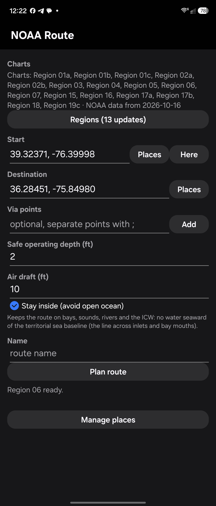

# Planning a route

The main screen, top to bottom.

## Charts

Shows the chart regions you have and how old their NOAA data is (for example "Charts: Region 04, Region 05 · NOAA data from 2026-10-16"). The **Regions** button says how many updates are waiting, for example **Regions (13 updates)**, and opens the Regions screen. See [Chart regions and updates](regions.html).

The line under **Plan route** shows what the app is doing: download progress ("Downloading Region 06: 1.2 of 3.6 MB", then "Region 06 ready."), where a shared point went ("Start set: ..."), or the result of planning.

## Start, Destination and Via points

Each point can be:

- typed as `LAT, LON` in decimal degrees (`39.25, -76.48`) or with hemispheres (`39.25 N, 76.48 W`),
- picked from **Places** (your saved spots),
- **Here** (Start only): your current GPS position,
- shared from OsmAnd or another app (see [Sharing points from OsmAnd](osmand.html#sharing-points-from-osmand)).

**Via points** are optional stops in order, separated by `;`. **Add** appends a saved place. Use a via point to force the route through a particular channel or to break up a very long trip.

A point on land or on a dock is moved to the nearest usable water, and the report says how far. The short leg between your point and that water is marked "connects your point to usable water: not checked, use your eyes", because it may cross the shore or a pier.

Once Start and Destination are filled in, a banner above **Plan route** names any chart region the trip needs that you have not downloaded, with a **Download** button.

## Safe operating depth (ft)

The shallowest **charted** depth you are willing to use: your draft plus a margin for tide, waves and chart error. The app plans so that every leg stays in water charted at least this deep wherever possible. Where it cannot (a creek, a marina entrance), it uses water that may be shallower only as briefly as possible and flags it in the report.

NOAA's depth areas usually step 0 / 6 / 12 ft, so at 3 ft most creeks fall into the "0-6 ft" band: usable, but flagged, with the shallowest nearby sounding. Depths are at MLLW (low water) with no tide added; on the Great Lakes, Low Water Datum.

Allowed values: 0 to 40 ft. The app remembers your last setting.

## Air draft (ft)

Your boat's height above the waterline. With it, the route goes only under bridge spans and power lines whose charted clearance covers it. Opening bridges (swing, bascule, lift) are passed and reported with their closed clearance, so you can check the opening schedule. Leave it empty and clearances are not checked at all.

## Stay inside (avoid open ocean)

Keeps the route on bays, sounds, rivers and the ICW. The note under the checkbox puts it as no water seaward of the line across inlets and bay mouths: the planner treats as open ocean the water reached from 12 nm offshore without crossing land or one of those lines. For example, Maryland to the Neuse River goes down the Chesapeake, through the ICW's Virginia Cut and the North Carolina sounds instead of around Cape Hatteras. If a point you entered is itself out in the ocean, the planner says so.

Without it, the planner takes the cheapest safe water, which can include the ocean along the beach or past a cape.

## Name

Optional. Routes are saved as `Download/noaa-charts/routes/<name>.gpx`, or `route_YYYYMMDD_HHMM.gpx` without a name. Planning again with the same name replaces that file.

## Plan route

Plans the route, shows the report and saves the GPX. Then:

- **Open in OsmAnd** sends the route to OsmAnd,
- **Show routes folder in Files** opens `Download/noaa-charts/routes` in Android's Files app,
- **Share GPX** sends the file to any app (email, messages, another navigation app).

Long trips (100+ nm, for example the Chesapeake down the ICW to the Carolinas) take longer: up to a minute on a phone for 400+ nm. Very long trips can cross several chart regions; download all of them first.

## When there is no route

If a point is boxed in, the app stops and says why: shallow water, land, a hazard buffer, or a bridge or power line too low for your air draft. It names the shallowest sounding or obstruction responsible, with its position. When depth is the limit, it suggests the deepest setting that gets out ("With a safe depth of 5 ft or less the water here leads out of this area"). Move the point into open water, or adjust the depth or air draft.

## Places

**Manage places** opens **Places (tap to edit or delete)**:

- **+ Add a place** opens **Add place**: a name and `LAT, LON` (filled in with Start), then **Save**.
- Tap a place to **Edit place**: change the name or position and **Save**, or **Delete** it.
- Saving under a name that already exists updates that place.

The list starts with six sample Chesapeake places (Maryland Marina, Hart-Miller Island beach, Bear Creek, Rock Hall Harbor, Annapolis Ego Alley, Chesapeake City dock), which you can edit or delete. The **Places** buttons next to Start and Destination, and **Add** next to Via points, pick from this list. You can also save a position shared from OsmAnd as a place, or save all waypoints of a GPX file at once.
