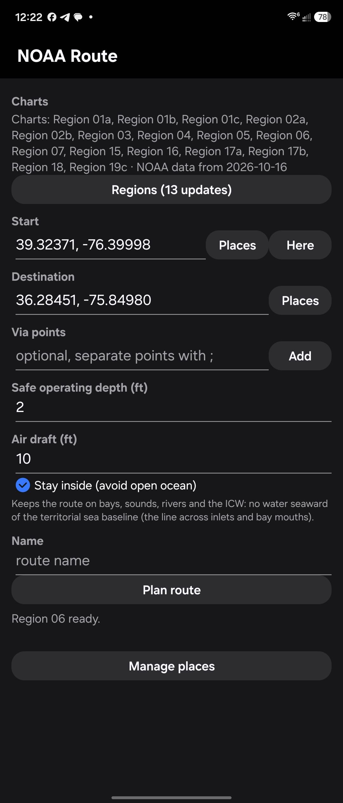
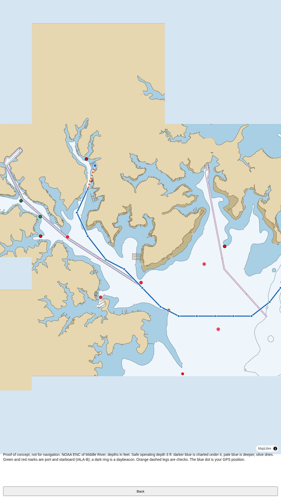
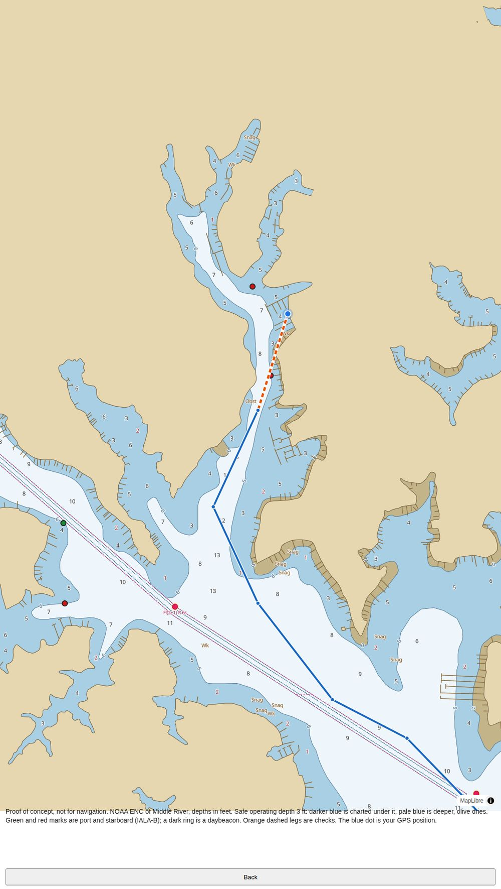

# Planning a route

The main screen, top to bottom.

## Charts

Shows the chart regions you have and how old their NOAA data is (for example "Charts: Region 04, Region 05 · NOAA data from 2026-10-16"). The **Regions** button says how many updates are waiting, for example **Regions (13 updates)**, and opens the Regions screen. See [Chart regions and updates](regions.html).

**View map**, under **Regions**, opens the Middle River chart with no route on it: depth contours, soundings and marks, shaded for the safe operating depth on the form (3 ft if that field is empty). On that screen, **Route data** can draw what the planner sees from a region you have downloaded. See [View on map](#view-on-map).

The line under **Plan route** shows what the app is doing: download progress ("Downloading Region 06: 1.2 of 3.6 MB", then "Region 06 ready."), where a shared point went ("Start set: ..."), or, after a plan, how many legs to check. The saved-file sentence is in the report, under that warning, not in place of it.

## Start, Destination and Via points

Each point can be:

- typed as `LAT, LON` in decimal degrees (`39.25, -76.48`) or with hemispheres (`39.25 N, 76.48 W`),
- picked from **Places** (your saved spots),
- **Here** (Start only): your current GPS position,
- shared from OsmAnd or another app (see [Sharing points from OsmAnd](osmand.html#sharing-points-from-osmand)).

**Via points** are optional stops in order, separated by `;`. **Add** appends a saved place. Use a via point to force the route through a particular channel or to break up a very long trip.

A point on land or on a dock is moved to the nearest usable water, and the report says how far. The short leg between your point and that water is marked "connects your point to usable water: not checked, use your eyes", because it may cross the shore or a pier.

Once Start and Destination are filled in, a banner above **Plan route** names any chart region the trip needs that you have not downloaded, with a **Download** button.

## Safe operating depth (ft)

The shallowest **charted** depth you are willing to use: your draft plus a margin for tide, waves and chart error. The app plans so that every leg stays in water charted at least this deep wherever possible. Where it cannot (a creek, a marina entrance), it uses water that may be shallower only as briefly as possible and flags it in the report.

NOAA's depth areas usually step 0 / 6 / 12 ft, so at 3 ft most creeks fall into the "0-6 ft" band: usable, but flagged, with the shallowest nearby sounding. Depths are at MLLW (low water) with no tide added; on the Great Lakes, Low Water Datum.

Allowed values: 0 to 40 ft. The app remembers your last setting.

## Air draft (ft)

Your boat's height above the waterline. The route goes only under bridge spans and power lines whose charted clearance covers it. Opening bridges (swing, bascule, lift) are passed. When the closed clearance is under your air draft, the note says the bridge has to open. When the closed bridge is high enough, the note says how many feet it clears by. Check the opening schedule either way.

The field is not optional. **Plan route** asks for a height unless **Don't check bridges and cables** is on. That checkbox is off until you turn it on, and it is remembered. Turn it on only when you mean to leave the field empty. The route then does not avoid a low bridge or power line. The report's first line says "Bridges and cables were not checked", the GPX description says the same, and every bridge or cable note is a check. A height you type is used even if the checkbox is on.

## Stay inside (avoid open ocean)

Keeps the route on bays, sounds, rivers and the ICW. The note under the checkbox puts it as no water seaward of the line across inlets and bay mouths: the planner treats as open ocean the water reached from 12 nm offshore without crossing land or one of those lines. For example, Maryland to the Neuse River goes down the Chesapeake, through the ICW's Virginia Cut and the North Carolina sounds instead of around Cape Hatteras. If a point you entered is itself out in the ocean, the planner says so.

Without it, the planner takes the cheapest safe water, which can include the ocean along the beach or past a cape.

## Move ends to navigable water

Off by default. Normally, a point in water charted under your safe depth (a marina in a 0-6 ft creek at 3 ft) is routed out through that water, and those legs are flagged; a point in water your boat cannot get out of is refused with "No route found" and an explanation of what closes it in. With this checked, a point in water charted entirely under your safe depth, or in the buffer around a charted hazard, starts or ends instead at the nearest usable water clear of hazard buffers, piers and markers, up to 0.5 nm away along the water. That water may itself be a band that may be under your depth, such as 0-6 ft at 3 ft. A point in such a band is not moved: a marina in a 0-6 ft creek at 3 ft starts where you put it, and its legs are flagged (orange in the chart, check markers in the GPX), the same as with the option off. The report says why a point moved, for example "Point 1 is in water charted entirely under your 3 ft; with Move ends to navigable water on, the route uses the nearest usable water clear of charted hazards, 180 m away. Check the way between on a chart." It is for a dock or a mooring up a creek shallower than your safe depth, or behind a bridge too low for your air draft, that you know how to get in and out of (on the tide, with the mast down).

For a boxed-in point, the report says which point moved, how far, and what closed it in, for example "Point 1: the water there is cut off by water shallower than your safe depth; with Move ends to navigable water on, the route uses the nearest water that leads out, 850 m away. Check the way between on a chart." The leg from your point to that water is marked "connects your point to usable water: not checked, use your eyes" and is a check, with check markers in the GPX. It is a straight line, not a route: it can cross shallows, a hazard, or a dock. It does not cross a bridge or cable your air draft cannot clear, or the land on the far side of one. The route stops on the near side and names the structure and its charted feet, for example "Point 2: overhead cable (clearance 20 ft) blocks the way to your point. With Move ends to navigable water on, the route stops on the near side, 700 m away, and does not cross it or the land beyond."

It applies to your start, destination and via points. A point on land or a dock is moved to the nearest usable water with or without it, and the report says "Point 2 is on land or a dock. The route uses the nearest usable water, 28 m away." Move ends does not walk that point farther, to deeper water. That walk was leaving the ICW at a pin on the shore, and at Ego Alley at 2 ft it skipped 110 m of the alley.

## Check markers in the GPX

On by default. The route's GPX file gets a waypoint where each stretch to check starts (orange, "Check: legs 16-18 (0.21 nm)") and where it ends (green, "Check ends: legs 16-18"), so OsmAnd and other chart apps show and, in OsmAnd, announce them. Off, the GPX has only the route, with each leg's notes in its points; the route points of legs to check are still named "check" (**WP09 check**). The route and the report are the same either way. See [In the GPX file](report.html#in-the-gpx-file).

## Name

Optional. Routes are saved as `Download/noaa-charts/routes/<name>.gpx`, or `route_YYYYMMDD_HHMM.gpx` without a name. Planning again with the same name replaces that file.

## Plan route

Plans the route, shows the report and saves the GPX. Read the report's notes before you go: see [Check the route before you go](#check-the-route-before-you-go). Then:

- **View on map** draws this route on a chart of Middle River inside the app (see [View on map](#view-on-map)),
- **Open in OsmAnd** sends the route to OsmAnd,
- **Show routes folder in Files** opens `Download/noaa-charts/routes` in Android's Files app,
- **Share GPX** sends the file to any app (email, messages, another navigation app).

Long trips (100+ nm, for example the Chesapeake down the ICW to the Carolinas) take longer: up to a minute on a phone for 400+ nm. Very long trips can cross several chart regions; download all of them first.

## Check the route before you go

{: .warning }
Every route needs checking. The planner keeps to water charted at least your safe operating depth wherever it can, but where it cannot (a creek, a marina entrance, a narrow channel) it goes on and flags the leg instead of stopping. A flagged leg is the planner telling you it could not prove that stretch safe.

After planning, read the [route report](report.html) leg by leg. Each leg with a note needs a look on a current chart before you leave:

- **shallow water**: "N m where charted depth may be under 5 ft" (your own safe depth in place of 5 ft): check the tide and the shallowest sounding named with it. The leg's note gives today's predicted tide range at the nearest station, and tapping the leg on the chart shows the times the tide is high enough ([Tides on the map](#tides-on-the-map)); the leg stays flagged, since wind can hold the water below the prediction,
- **chart depth areas**: "crosses N m of a depth area that straddles your 5 ft" or "crosses N m charted entirely under your 5 ft", when the leg line crosses that area on a chart downloaded in the app (or the bundled Middle River chart),
- **"check" notes**: a hazard the leg passes close to (named, with its depth and distance), a channel marker passed on the wrong side, piers or seawalls, piles or snags,
- **"connects your point to usable water"**: the legs at either end, which are not checked at all,
- **bridges and cables**: clearances and opening schedules. With **Don't check bridges and cables** on, these notes are checks too, and the report's first line says the clearances were not checked,
- **restricted areas**: their rules.

[What each note means](report.html#what-each-note-means) explains every note and what to do about it. With **Check markers in the GPX** on, each stretch of flagged legs also has an orange start and a green end marker in OsmAnd, which announces them as you approach (see [In the GPX file](report.html#in-the-gpx-file)). Underway, follow the buoys rather than the line and watch the depth sounder where the report flags shallow water. See also [What to check yourself](safety.html#what-to-check-yourself).

### Try to avoid checks

When the route has legs to check, a **Look for a way around the checks** button appears under the report. It replans each stretch of flagged legs on its own, this time treating the causes of the checks (shallow water, the hazard buffer, piers and seawalls, piles, security zones) as land, and keeps the new stretch only if:

- its checks are gone (or, failing that, its "check" notes are gone and what is left is shallow water no longer than before), and
- it is no more than 0.2 nm or 10% longer than the old stretch, whichever is more.

Your start, via points and destination never move, and the legs at either end that connect your points to usable water are left alone. The status line says what happened, for example *Avoid checks: 1 of 3 check stretches resolved (+0.12 nm), 2 unchanged (no way around within 0.2 nm or 10% of the stretch).* A stretch with no small way around (a creek or marina entrance that is shallow all the way across) stays as it was, still flagged.

If anything changed, the adjusted route is saved as a new file, `<name>_adjusted.gpx`, and the report, **View on map**, **Open in OsmAnd** and **Share GPX** switch to it; the original route file is unchanged. The adjusted route still needs checking: read its report the same way.

## View on map

A proof of concept, and not a replacement for OsmAnd. **View map**, under **Regions**, opens the chart with no route on it. **View on map**, under the report, draws this route on that chart.

Any region whose published catalog includes a chart can be downloaded: **Download** on the chart screen for the region under the map, or **Download chart** on that region's card under **Regions**. The button names the region and the size. The download waits for Wi-Fi unless you allow mobile data, shows its progress, and checks the file. After that it works with no signal. It stays in the app. It is not a file under Download/noaa-charts and it is not an OsmAnd map. When a newer chart is published, the button says **Update**. Today the catalog publishes Region 04 (upper Chesapeake and Delaware Bay, about 32 MB). A later weekly build that adds another region's chart shows up here without a new app. The chart's own zoom range is in the file. Pinching in further enlarges that same picture.

**Base map.** Each region also has an OpenStreetMap base map for the chart: roads with their names, towns, state and county lines, ferries and rail, and marinas, beaches and ferry terminals, for knowing where you are from the shore. County lines are thin purple dashes (state lines heavier), out over the water as well, from the Census Bureau's county boundaries. From zoom 11 they are labeled along the line, one county's name on each side, with the line running between the two names. **Download Region 04 base map, roads and towns** sits under the chart's own button on the chart screen, and **Download base map** on the region's card under **Regions** (Region 04 is about 59 MB). Like the chart, it waits for Wi-Fi unless you allow mobile data, is checked, and then works with no signal. Once it is downloaded, **Base map (OpenStreetMap)** is a checkbox at the top of the chart, on until you turn it off. The roads and names draw on NOAA's land, under the chart's contours, soundings, marks and the route, so nothing on the chart is hidden. It has no depths and no water of its own: the blues and the shoreline are NOAA's, and OpenStreetMap's idea of the shore can differ a little. Map data © OpenStreetMap contributors, cut from a Protomaps build; county names from US Census Bureau TIGER/Line; it is rebuilt monthly.

**Search** sits above **Follow** on the chart. Type part of a name: "mid riv", "bowleys", "light 2", "bay bridge". It looks through the names in what you have downloaded: buoys, daybeacons, lights (with their characteristic), bridges, dredged channels, fairways and wrecks from the region charts; towns, neighborhoods, marinas, beaches, ferry terminals and roads from the base maps; bridges and restricted areas from the route data. Every word has to start a word of the name, and the nearest matches to the middle of the map come first, with their distance. Tap one and the map moves there, with a purple ring and the name. Follow turns off. Press and hold there to add it as a via point or destination. Charts downloaded before search came out have no names in them yet; **Update** the chart when it is offered.

If a download sits at 0 MB, the button says why, from Android's download list: queued, waiting for Wi-Fi (Android counts this connection as metered: cancel and choose **Use mobile data too**), waiting for a network, or waiting to retry.

Every region chart you have downloaded is drawn together, so panning from one region into the next (Region 04 into 05 at 38.23 N) keeps the chart continuous. The title names the regions drawn. **Download** offers the region in the middle of the map, or under the route, when it is not downloaded yet. If no region chart is downloaded, the screen uses the Middle River chart that comes with the app (the marina creeks out to the bay off Hart-Miller Island, about 1 MB). The first open copies that file into the app's private storage (about 1.1 MB with the labels). An app update replaces the copy when the chart itself has changed. A route that leaves the chart on screen is still drawn the whole way, and the screen says the chart stops.

The buoy or daybeacon is the green or red mark (a dark ring is a daybeacon). The small dot just above it is the light, in the light's own colour.

The shading follows your safe operating depth. Strong blue is charted entirely under it, lighter blue may be under it (the 0-6 ft band at a 3 ft or 5 ft setting), and pale blue is at or over it. A sounding in red is under it. North is up. The key under the map is a paragraph. Tap it to hide it. What stays is one line, "Not for navigation. Show key", and the map uses the space. Tap that line to open the key again. The choice is remembered the next time you open the chart.

**Follow** sits on the chart. It moves the map to your GPS fix and keeps it there as the boat moves. Pan the chart with one finger and Follow turns off; pinch or double-tap to zoom and Follow stays on at your zoom. If location is not allowed, or GPS is off, the chart says so and stays where it is. **Course up** (tap **North up** to switch) turns the chart with your heading while Follow is on, once the boat is moving. In Course up the boat sits three quarters of the way down the screen, so most of the chart shows what is ahead; North up keeps the boat in the middle. While Follow is on and the boat is moving, a blue heading line runs from the blue dot along your GPS course (course over ground, not the way the bow points) to past the edge of the chart, with a ring labeled "1 min" where you will be in a minute at your current speed; it goes away when the boat stops or Follow turns off. The box above **Search** shows your GPS speed over ground in mph ("-- mph" until a fix comes, or when none has come for 10 seconds). The chart asks for a GPS fix every second while it is open. The compass shows which way the top of the chart points. Tap the compass to put north up again. North up is the start. The key says which one is on. Olive is drying ground. Soundings are whole feet, in red when they are under your safe depth. Green marks are port and red marks are starboard, the IALA-B colors used on the Chesapeake; a mark with a dark ring is a daybeacon, and the small dot above it is its light, in that light's colour. Legs the report tells you to check are drawn orange and dashed. Each leg is numbered with its row in the report. Tap a leg to open its details: the leg is highlighted in yellow, the title says "Leg 12: check" for a leg to check, and the box gives the course and distance, then each note on its own line. **Add via here** and **Destination here** in that box use the spot you tapped. Press and hold anywhere on the chart, on the route or not, for **Depth and tide here** (see [Tides on the map](#tides-on-the-map)), **Set as start**, **Add as via point** or **Set as destination**. Each goes back to the planning screen with that position filled in: a start or destination replaces the old one, and a via point is put between the trip points where it adds the least distance. When the trip has a start and a destination, the app plans it and opens the chart on it. When one is still empty (View map opened with no route), the planning screen says which to set, and planning waits for it. If that trip cannot be planned, you stay on the planning screen with the reason in the report, and the via or destination stays in its field to change or remove. A bridge or cable marked for vertical clearance is not drawn in that orange. Restricted areas the report names are outlined in purple dashes, with the name and CFR section along the edge: a heavy line where entry is restricted or prohibited or for a security zone, a light line for anchoring, fishing or other rules. They come from your downloaded regions' route data, so they show on any chart, Route data on or off. Overhead cables from the route data are dashed lines labeled with their clearance ("cable 55 ft"), red when that is under your air draft or not charted, or when no air draft is set, navy when it clears. Tap a restricted area or a cable, away from the route, for its rule or clearance in the report's words, with the same **Add via here** and **Destination here** buttons. Where a run of check legs starts, an orange pin with ! sits on the route, and a green pin where it ends, like the check markers in the GPX. The blue dot is your GPS position, once you allow location.

### Route data

**Route data** is a checkbox on the chart, off until you turn it on, and remembered after that. It draws what the route planner sees, from the route pack already downloaded for a region, on top of whichever chart is showing (a downloaded region chart, or the bundled Middle River chart). It stays on when the chart switches after a download. It sits above the chart picture and under the route line. It does not need a connection. Land and cells with no pack data stay clear, so the chart shows through.

The marks follow the safe operating depth and air draft for this screen. **View map** uses the form, and saves the depth you typed so it is still there after the app restarts. If the depth field is empty or not feet from 0 to 40, a message says so and the chart is shaded for 3 ft. A decimal comma (3,5) is read as 3.5 ft. **View on map** uses the depth and air draft the route was planned with. With no air draft, span and cable clearances are not marked, the same as planning with **Don't check bridges and cables** on. A bridge deck with no charted clearance is still marked, because the planner will not go under it.

Depth stays the chart's own blues (strong blue entirely under your safe depth, lighter blue straddling it, pale blue deep enough). Route data does not paint those again in red or amber. Orange on the route line is a leg to check. A bridge or cable the boat cannot clear is marked for vertical clearance, in maroon or navy, not in that orange. The number on a leg is its row in the report. Tap the leg to read its note.

| Colour | What the planner sees |
|---|---|
| Bright red | Hazard: an obstruction the planner treats as a wall, or a sounding under your depth |
| Black | Pier, seawall or other structure |
| Purple hatch | Entry prohibited |
| Maroon | Bridge, vertical clearance too low for your air draft, or a deck with no charted clearance |
| Navy | Overhead cable, vertical clearance too low or not charted, when air draft is set |
| Cyan | Wrong side of a channel marker |
| Brown | Pile or snag |
| Clear | Land, charted depth (the chart's blues), or no route-pack data |

Opening bridges are not marked as too low: the planner goes through them and the report names them. The bright red cell is the hazard itself. The planner's keep-off buffer around that cell is not drawn. The screen says it is not for navigation. This layer is the planner's 20 m grid, not a chart to steer by. If you have not downloaded a route pack for the area on screen, the checkbox says so. Zoomed well out, one pixel covers several cells, and a hazard or marker in that square still shows.

**Open in OsmAnd** is unchanged, and it is still how you follow a route. The screen says it is not for navigation: check the route on a current chart before you go, the same as the report. A trip that runs past the chart on screen is drawn past that edge as the line alone. Download the next region's chart from **Regions** when the catalog lists one.

  
  

*View on map for a 3 ft safe operating depth. Left: the route from the marina down Middle River, the orange dashed stretch is a leg to check, and the blue dot is the GPS position. Right: the same spot closer in, with soundings, marks, a wreck and snags.*

### Tides on the map

The chart shows NOAA's predicted tides, from the same saved predictions as the report (see [Reading the route report](report.html#tides)). Heights are feet above chart datum (MLLW), the datum of the chart's depths, on the phone's clock. Every tide box ends with the same reminder: *Predicted, not observed. Wind and pressure can move the water feet from this, most of all on the Chesapeake in a northwest wind.*

**Tide stations.** From zoom 9, NOAA tide stations in your downloaded regions are teal dots, named from zoom 11. A filled dot has a year of predictions saved on the phone; a hollow one has none yet. Tap a dot for **Tides**: today's highs and lows, the height now and whether it is rising or falling, and a curve of the day from midnight to midnight with a line at the current time. A station with nothing saved is fetched from NOAA while the box is open (about 70 KB); with no connection the box says it is not downloaded yet. **Add via here** and **Destination here** work as for a leg.

**Check legs.** Tapping a leg to check also shows the tide at the nearest station, with its distance. On a leg flagged for water that may be under your safe depth, a red dotted line on the curve marks the tide you need: your safe depth minus the shallowest sounding charted within 100 m of the leg. For a 5 ft safe depth and a 3.9 ft sounding, the line is at 1.1 ft. Under the curve the box lists the times today the predicted water is above that line ("Above it today: 4:12 am to 9:40 am, 3:05 pm to 10:30 pm"), or says the tide does not reach it. With no sounding charted near the leg, there is no line: the box says the tide needed cannot be worked out from the chart. Shallower water may be uncharted, so the line is a guide, not a promise.

**Depth and tide here.** Press and hold a spot and pick **Depth and tide here** for what the downloaded chart says there: the depth area ("Depth area: 0 to 6 ft, may be under your 5 ft"), a dredged area's charted depth, and the shallowest and nearest soundings within 150 m with their distances. Below it is the nearest station's tide with the same red dotted line, drawn for the shallowest sounding (or, with none, the dredged depth, then the depth area's shallow limit; the box says which), and the times above it today. With at least three soundings within 500 m (the nearest within 200 m; Chesapeake soundings are often 300-500 m apart), the box also estimates the charted depth at the spot itself: the nearest soundings (up to eight) averaged with closer ones counting more, kept within the depth area's range ("Estimated charted depth here: about 4.5 ft"). It adds the tide now ("Predicted depth here now: about 5.6 ft") and gives the times today the estimate reaches your safe depth. The bottom between soundings is not charted, so the estimate can miss a lump or a hole; the red dotted line stays on the shallowest sounding, the cautious reading. It needs a downloaded chart for that spot, or the bundled Middle River chart.

**Predicted depth (tide now).** A checkbox at the top of the chart, off each time the chart opens. When on, every sounding and depth contour label shows its charted depth plus the predicted tide now at the station nearest the middle of the map, rounded down to whole feet, in teal so it does not read as a charted depth, and red when under your safe depth. It updates every minute and when you move the map. The key names the station, the height added and the time. The depth area colors stay charted depth, and so does planning. With no station within 30 km of the middle of the map, or no predictions yet, the key says so and the labels are charted depth. Uncheck it to go back to the chart's own labels.

{: .warning }
> Tides are predictions. A northwest wind on the Chesapeake can hold the water a foot or two below them, sometimes for days. Use the depth sounder, and treat a flagged leg as flagged whatever the tide says.

## When there is no route

If a point is boxed in, the app stops and says why: shallow water, land, a hazard buffer, or a bridge or power line too low for your air draft. It names the shallowest sounding or obstruction responsible, with its position. When depth is the limit, and a full plan at a shallower setting joins the two ends, it suggests that setting ("With a safe depth of 5 ft or less the water here leads out of this area"). A low bridge or cable is not answered with a shallower depth. Move the point into open water, or adjust the depth or air draft.

## Places

**Manage places** opens **Places (tap to edit or delete)**:

- **+ Add a place** opens **Add place**: a name and `LAT, LON` (filled in with Start), then **Save**.
- Tap a place to **Edit place**: change the name or position and **Save**, or **Delete** it.
- Saving under a name that already exists updates that place.

The list starts with six sample Chesapeake places (Maryland Marina, Hart-Miller Island beach, Bear Creek, Rock Hall Harbor, Annapolis Ego Alley, Chesapeake City dock), which you can edit or delete. The **Places** buttons next to Start and Destination, and **Add** next to Via points, pick from this list. You can also save a position shared from OsmAnd as a place, or save all waypoints of a GPX file at once.
