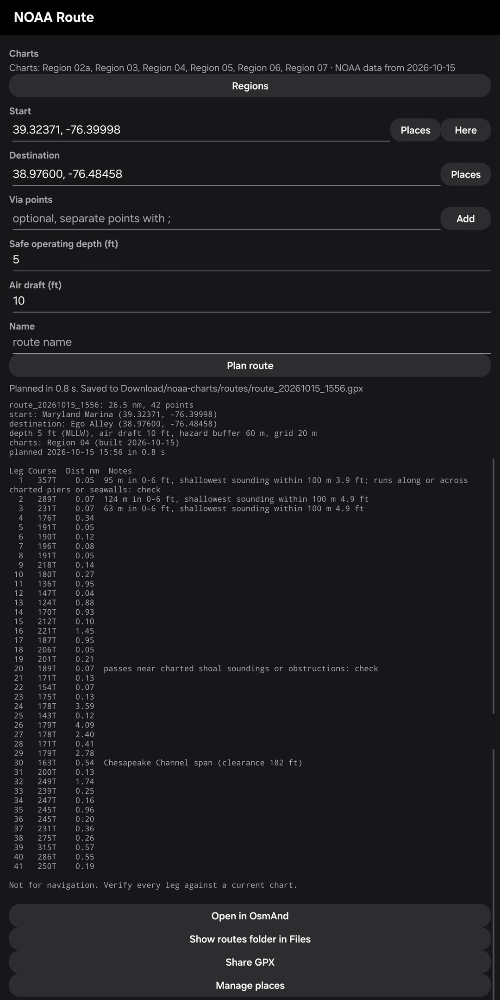
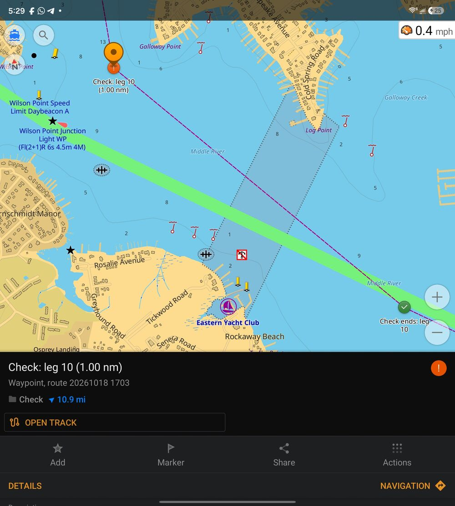
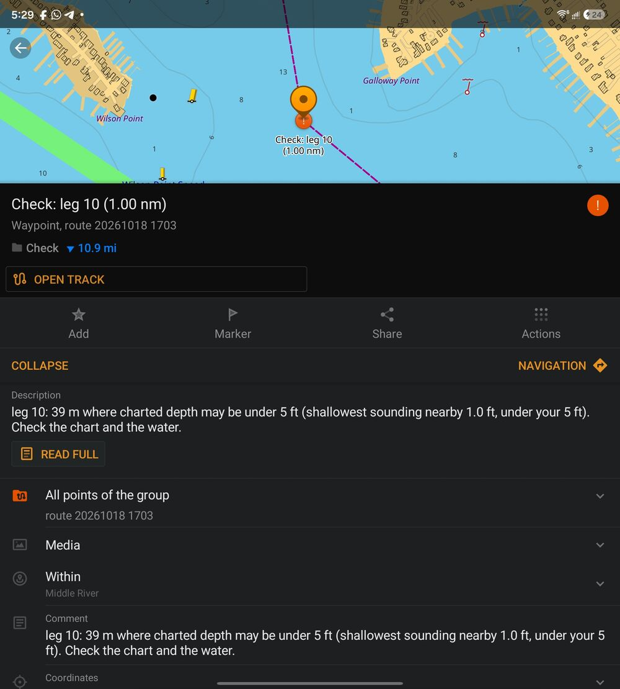

# Reading the route report

After **Plan route**, the report appears under the button. You can select and copy its text.

## The header

```
Annapolis trip: 26.5 nm, 38 points
depth 5 ft (MLLW), air draft 10 ft, hazard buffer 60 m, grid 20 m
```

- The total distance and number of route points.
- Your start, via points and destination.
- The settings it was planned for, and what depths are charted to (MLLW, or Low Water Datum on the Great Lakes).
- **grid 20 m**: the chart detail the route was planned on. Long trips add "(long trip, guided by a 320 m overview)": the trip was sketched on a coarse grid first, then planned at 20 m stretch by stretch.
- The charts (regions) used and when it was planned.
- Messages, such as "Point 1 moved 35 m to the nearest usable water".

## The legs

The examples on this page come from a route planned with a **Safe operating depth** of 5 ft. Wherever a note says "5 ft" ("under 5 ft", "under your 5 ft"), your report shows your own safe operating depth instead.



*The report in the app: Maryland Marina to North Carolina with Stay inside on, 417.6 nm at a 5 ft safe operating depth. Legs 1-3 leave the marina through water where the charted depth may be under 5 ft; leg 16 crosses restricted areas and leg 17 passes under the Eastern Channel span (58 ft clearance).*

```
Leg Course  Dist nm  Notes
  1   357T    0.05  95 m where charted depth may be under 5 ft, shallowest sounding within 100 m 3.9 ft, under your 5 ft
  2   136T    1.00
  3    84T    1.06  passes 25-45 m from a charted 3.2 ft sounding: check
```

**Course** is true (T), not magnetic. **Dist** is nautical miles. A leg with no notes stays in water charted at least your safe depth, clear of everything below.

## What each note means

| Note | Meaning | What to do |
|---|---|---|
| **N m where charted depth may be under D ft, shallowest sounding within 100 m X ft** | D is your **Safe operating depth** setting (your draft plus a margin). That much of the leg is in a charted depth band that spans D (NOAA's 0-6 ft band for a 3 or 5 ft safe depth, the 6-12 ft band for 8 ft). The shallowest charted sounding near it is X ft, and "under your D ft" follows it when it is shallower than your safe depth; "no soundings within 100 m" means there are none charted. | Check the chart and the tide. Go slowly and watch the depth sounder. |
| **passes 25-45 m from a charted 3.2 ft sounding: check** (or *a charted obstruction (2.1 ft)*, *(depth unknown or 0 ft)*, *charted piles or snags*) | The leg uses the safety buffer (60 m) around a shallow sounding, rock, wreck or obstruction, because there was no other way; over water charted deep enough, the hazard itself is always avoided. The note names the closest one and its charted depth. The distance is how close the leg's line comes to it, as a range the size of a 20 m grid cell, since positions are known to that cell. Rocks, wrecks and other obstructions are all called obstructions. A stretch of legs past the same hazard names it once. | Find the hazard on the chart and give it room. |
| **passes over or on the wrong side of a channel marker: check** | The leg crosses the wrong side of a lateral buoy or daybeacon. The planner does this only when there is no other way. | Check the marks on the chart; keep red right returning. |
| **runs along or across charted piers or seawalls: check** | The leg runs along or crosses a charted pier, seawall, jetty or breakwater line, for example into a slip. | Steer by eye; the chart line may not match the dock. |
| **passes charted piles or snags: check** | The leg passes old pilings or snags of unknown depth. | Look for them and stay clear. |
| **connects your point to usable water: not checked, use your eyes** | The short leg from your point to the nearest usable water. It may cross a dock or the shore. | Steer it by eye. |
| **Bridge name: swing (or bascule, lift) bridge, may need an opening (closed clearance N ft)** | An opening bridge on the route. | Check its opening schedule and call ahead if needed. |
| **Bridge name span (clearance N ft)** | A fixed bridge span you clear by your air draft. | Check the clearance board; water levels vary. |
| **Cable name (clearance N ft)** or **(clearance not charted)** | An overhead cable. | Make sure your air draft clears it with margin. |
| **Area name: rules (CFR)** | A restricted area: no wake, anchoring rules, entry restricted, or an area to be avoided by large ships. | Read the rule; the route is not blocked by it. |
| **Zone name: security zone, may be enforced (check the regulation and Local Notice to Mariners) (33 CFR 165.xxx)** | A Coast Guard security zone that applies only around particular vessels (tankers, cruise ships, escorted vessels) or when the Coast Guard announces it. Permanent security zones, fixed areas that are always closed, are never used. | Check the Local Notice to Mariners and listen on VHF 16; keep out of the zone when it is enforced. |

## How the shallow-water note is measured

Take "95 m where charted depth may be under 5 ft, shallowest sounding within 100 m 3.9 ft, under your 5 ft", from a route planned with a **Safe operating depth** of 5 ft:

- **95 m** is an estimate of how much of the leg runs through a charted depth area whose range reaches below your safe depth. The planner samples the leg's straight line about every 10 m on its 20 m grid, counts the samples in such water, and takes that share of the leg's length (a single sample is ignored as grid noise). Read it as roughly that length, give or take a cell or two. It means the chart does not promise your safe depth there, not that it is that shallow throughout. When it equals the leg's length, as on a first leg out of a slip, the whole leg is in that water.
- **3.9 ft** is the shallowest charted sounding within 100 m of any part of the leg: a strip about 200 m wide along the leg's line, with rounded ends. It is not a circle around the route point that carries the note, so on a long leg the sounding can be anywhere along it, up to 100 m to the side. The route keeps a buffer around soundings shallower than your safe depth, so it does not pass over that spot, but it is close.

```
        ╭───────────────────────────────╮   ↑
       (  WP09 ●━━━━━━━━━━━━━━━━━● WP10  )  100 m each side
        ╰───────────────────────────────╯   ↓
```

Only legs with a shallow length get a sounding. A leg entirely in water charted at least your safe depth has no note, even with a shallow sounding charted nearby.

## In the GPX file

Each route point in the GPX file carries a short description of the next leg, with all its notes, which OsmAnd shows when you tap the point (here for a 5 ft safe operating depth):

```
Next: 357 T, 0.05 nm, 95 m where charted depth may be under 5 ft (shallowest sounding nearby 3.9 ft, under your 5 ft)
```

Points are named **Start**, **WP01**, **WP02** ... **End**. The file description says the total distance, the depth it was planned for, and "Not for navigation".

With **Check markers in the GPX** on (the default; see [Planning a route](planning.html#check-markers-in-the-gpx)), every stretch of legs to check also gets two waypoints:

- **Check: legs 16-18 (0.21 nm)** where the stretch starts: an orange warning triangle in OsmAnd, with the notes of each leg in it.
- **Check ends: legs 16-18** where it ends: a green check mark.

A leg is checked when it has water that may be under your safe depth or a note ending in "check" (or "not checked"); bridge, cable and restricted area notes are information only. The route points of checked legs are named with "check" (**WP09 check**). Both markers are in OsmAnd's **Check** group, which you can hide, and OsmAnd announces them during navigation when **GPX waypoints** is on in its voice prompts. Other chart apps show them as ordinary waypoints (symbol `Danger Area` and `Flag, Green`).




*Left: a stretch to check in OsmAnd, from the orange start marker to the green end marker. Right: tapping the start marker shows its notes and the Check group. The route was planned with a 5 ft safe operating depth, so its notes say "under 5 ft".*
