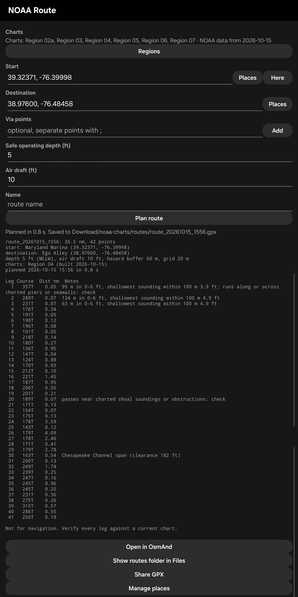
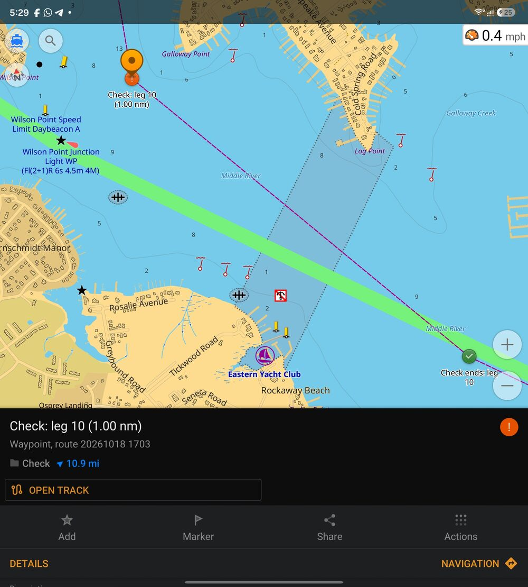
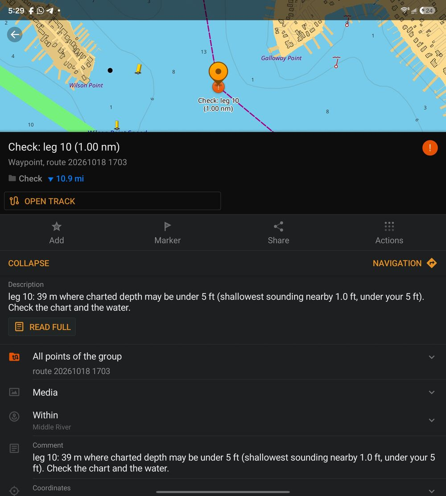

# Reading the route report

After **Plan route**, the report appears under the button. You can select and copy its text.

## The warning, then the header

The first lines are the checks, before the leg table and before the sentence that says where the file was saved. A route with nothing flagged still says to verify every leg. Entry restricted and entry prohibited are listed here and the leg is a check. Anchoring, fishing and no-wake rules are listed too, and they stay information unless the leg is also shoal.

```
2 legs to check, in 1 stretch. Look at each one on a current chart before you go.
2 legs are in water that may be under your 5 ft.
1 bridge: Eastern Channel span (vertical clearance 58 ft)
1 restricted area: ... entry restricted ...
Not for navigation. Verify every leg against a current chart.
Saved to Download/noaa-charts/routes/....gpx

Annapolis trip: 26.5 nm, 38 points
depth 5 ft (MLLW), air draft 10 ft, hazard buffer 60 m, grid 20 m
tides at North Point, Sun Nov 8 (predicted, feet above chart datum): low 0.4 ft 12:21 am, high 1.1 ft 5:28 am, low 0.1 ft 11:38 am, high 1.6 ft 6:17 pm
tides at Annapolis (US Naval Academy), Sun Nov 8 (predicted, feet above chart datum): low 0.5 ft 3:21 am, high 1.1 ft 8:41 am, low 0.1 ft 2:54 pm, high 1.5 ft 9:44 pm
tides: Predicted, not observed. Wind and pressure can move the water feet from this, most of all on the Chesapeake in a northwest wind.
```

Shoal rows are coloured dark red, bridges blue, cables purple, restricted areas purple, and the check count a deep orange. That orange is the report text. On the chart, the dashed check leg is orange and a cable drawn for vertical clearance is navy, so the two are not the same mark.

- The total distance and number of route points.
- Your start, via points and destination.
- The settings it was planned for, and what depths are charted to (MLLW, or Low Water Datum on the Great Lakes).
- **grid 20 m**: the chart detail the route was planned on. Long trips add "(long trip, guided by a 320 m overview)": the trip was sketched on a coarse grid first, then planned at 20 m stretch by stretch.
- **Tides**: today's predicted highs and lows at the NOAA tide station nearest the start, and at the one nearest the destination when that is a different station, in feet above chart datum on the phone's clock, then the reminder that they are predictions. See [Tides](#tides) below.
- The charts (regions) used and when it was planned.
- Messages, such as "Point 1 moved 35 m to the nearest usable water".

## The legs

The examples on this page come from a route planned with a **Safe operating depth** of 5 ft. Wherever a note says "5 ft" ("under 5 ft", "under your 5 ft"), your report shows your own safe operating depth instead.



*The report in the app: Maryland Marina to North Carolina with Stay inside on, 417.6 nm at a 5 ft safe operating depth. Legs 1-3 leave the marina through water where the charted depth may be under 5 ft; leg 16 crosses restricted areas and leg 17 passes under the Eastern Channel span (58 ft clearance).*

```
Leg Course  Dist nm  Notes
  1   357T    0.05  95 m where charted depth may be under 5 ft, shallowest sounding within 100 m 3.9 ft, under your 5 ft
  2   136T    1.00
  3    84T    1.06  passes 25-45 m from a charted 3.2 ft sounding: check
```

**Course** is true (T), not magnetic. **Dist** is nautical miles. A leg with no notes stays in water charted at least your safe depth, clear of everything below.

## What each note means

| Note | Meaning | What to do |
|---|---|---|
| **N m where charted depth may be under D ft, shallowest sounding within 100 m X ft** | D is your **Safe operating depth** setting (your draft plus a margin). That much of the leg is in a charted depth band that spans D (NOAA's 0-6 ft band for a 3 or 5 ft safe depth, the 6-12 ft band for 8 ft), on the planner's 20 m grid. One such cell is enough. The shallowest charted sounding near it is X ft, and "under your D ft" follows it when it is shallower than your safe depth; "no soundings within 100 m" means there are none charted. | Check the chart and the tide. Go slowly and watch the depth sounder. |
| **crosses N m of a depth area that straddles your D ft: check** | The leg's line crosses a depth area on a chart downloaded in the app (or the bundled Middle River chart) whose shoal limit is under D and whose deep limit is not. The grid can miss this when the shoal sits in the fringe of a cell whose center is deeper. | Look at that patch on the chart before you go. The line drawn on the chart is the line to check. |
| **crosses N m charted entirely under your D ft: check** | The same check, for an area whose deep limit is also under D. The whole area is charted shallower than your safe depth. | Do not treat that stretch as navigable. Find another line, or go only with enough tide. |
| **passes 25-45 m from a charted 3.2 ft sounding: check** (or *a charted obstruction (2.1 ft)*, *(depth unknown or 0 ft)*, *charted piles or snags*) | The leg uses the safety buffer (60 m) around a shallow sounding, rock, wreck or obstruction, because there was no other way; over water charted deep enough, the hazard itself is always avoided. The note names the closest one and its charted depth. The distance is how close the leg's line comes to it, as a range the size of a 20 m grid cell, since positions are known to that cell. Rocks, wrecks and other obstructions are all called obstructions. A stretch of legs past the same hazard names it once. | Find the hazard on the chart and give it room. |
| **passes over or on the wrong side of a channel marker: check** | The leg crosses the wrong side of a lateral buoy or daybeacon. The planner does this only when there is no other way. | Check the marks on the chart; keep red right returning. |
| **runs along or across charted piers or seawalls: check** | The leg runs along or crosses a charted pier, seawall, jetty or breakwater line, for example into a slip. | Steer by eye; the chart line may not match the dock. |
| **passes charted piles or snags: check** | The leg passes old pilings or snags of unknown depth. | Look for them and stay clear. |
| **tide today at North Point: 0.1 to 1.6 ft above chart datum (predicted)** | Added to a leg already flagged for water that may be under your safe depth: the lowest and highest predicted water today at the NOAA tide station nearest the leg (within 30 km). It is information. The leg stays flagged, and the route was planned on charted depth. | Use it with the shallowest sounding: a 3.9 ft sounding has about 4.0 to 5.5 ft over it today, before wind. On the chart, tap the leg for the day's curve and the times the water is high enough (see [Planning a route](planning.html#tides-on-the-map)). |
| **connects your point to usable water: not checked, use your eyes** | The short leg from your point to the nearest usable water. It may cross a dock, the shore, or shallow water. It does not cross a bridge or cable your air draft cannot clear. When that structure is in the way, there is no such leg: the route stops on the near side and the message names the charted feet. | Steer it by eye. |
| **crosses about N m of land, water charted under your 5 ft, or a structure the planner keeps off: check** | On a leg you made with Delete leg or imported with Import GPX: the straight line crosses land, water charted under your safe depth, or a pier, bridge deck or other structure, which a planned leg never does. | Look at it on a current chart; usually the waypoint you deleted was what kept the route off it. Plan again, or add a via point where you want the route to go. |
| **a straight leg you made with Delete leg, not planned** | The leg joins the legs on either side of a waypoint you deleted on the chart. It was checked like a planned leg, but the planner did not choose it. | Check it like any other leg. The route is saved as its own file, name_edited.gpx; the original stays. |
| **Bridge name: swing (or bascule, lift) bridge has to open (closed clearance N ft, under your air draft)** or **clears when closed (closed clearance N ft, M ft over your air draft)** | An opening bridge on the route. With no air draft the note still says it may need an opening. | Check its opening schedule and call ahead when it has to open. |
| **Bridge name span (vertical clearance N ft)** | A fixed bridge span you clear by your air draft. The number is the height under the span, not the width. With **Don't check bridges and cables** on, the same note ends in "check": the span was not tested. | Check the clearance board; water levels vary. |
| **Cable name (clearance N ft)** or **(clearance N ft (N.N ft))** or **(clearance not charted)** | An overhead cable. The tenth of a foot is shown when the chart's whole-foot label rounds up, so 54.8 ft is not printed as 55. A cable beside the route, not on it, says so and is not a check. With **Don't check bridges and cables** on, a cable the route crosses ends in "check". | Make sure your air draft clears it with margin. |
| **Area name: entry restricted, or entry prohibited (CFR)** | The leg crosses water where entry is restricted or prohibited. The note stays on each leg that is still inside the area, so a long zone is not silent after the first leg. Aberdeen Proving Ground (33 CFR 334.140) adds that it is a firing danger zone and that the ship channel south of Pooles Island is the other way. The C&D Canal (33 CFR 162.40) is a canal traffic rule: anchoring is restricted, and the note does not say entry is restricted. The lower Chesapeake Bay and Hampton Roads regulated navigation area (33 CFR 165.501) reads "regulated navigation area, rules for large and deep-draft vessels and anchoring" and is not a check. The leg is a check when entry is restricted or prohibited, with the orange dashed line and a check marker in the GPX. | Read the rule. Do not enter water where entry is prohibited. |
| **Area name: other rules (CFR)** | No wake, anchoring, fishing, or an area to be avoided by large ships. | Read the rule. The route is not blocked by it, and the leg is not a check unless it is also shoal. |
| **Zone name: security zone, entry may be prohibited: check (33 CFR 165.xxx)** | The leg crosses a Coast Guard security zone. When only part of the leg is inside, the note says about how many meters of that leg. Some zones are always closed (the Cove Point LNG terminal, nuclear plants, Navy bases), others only around particular vessels or when the Coast Guard announces them; the charts do not say which, so the route is not changed. | Read the regulation and the Local Notice to Mariners. If entry is prohibited, tap [Look for a way around the checks](planning.html#try-to-avoid-checks) or add a via point to go around the zone, or call the Coast Guard on VHF 16 for permission. |

## Tides

The tide lines are NOAA's own predictions, fetched from NOAA's tide service (CO-OPS) a year at a time for each station and kept on the phone, so they work offline. Heights are feet above chart datum (MLLW), the same datum as the depths on the chart, so a 3.9 ft sounding with 1.2 ft of predicted tide has about 5.1 ft over it. Times are on the phone's clock.

They do not change the route. The planner still uses charted depth: a late start, a northwest wind on the Chesapeake, high pressure or low river flow can hold the water a foot or more below the prediction, and a route planned on the tide could then lead onto water that is not there. Use the tide to judge a flagged leg, not to replace the check.

When planning, the app fetches the stations a trip needs on any network (about 70 KB each). With no connection and nothing saved for a station, the report says so in a "tides:" line. Great Lakes regions have no tide stations, and the report has no tide lines there.

## How the shallow-water note is measured

Take "95 m where charted depth may be under 5 ft, shallowest sounding within 100 m 3.9 ft, under your 5 ft", from a route planned with a **Safe operating depth** of 5 ft:

- **95 m** is an estimate of how much of the leg runs through a charted depth area whose range reaches below your safe depth. The planner samples the leg's straight line about every 10 m on its 20 m grid, counts the samples in such water, and takes that share of the leg's length. One such cell is enough. Read it as roughly that length, give or take a cell or two. It means the chart does not promise your safe depth there, not that it is that shallow throughout. When it equals the leg's length, as on a first leg out of a slip, the whole leg is in that water. A separate note, "crosses N m of a depth area that straddles your D ft", measures the same kind of crossing on the chart drawn in the app, along the leg line itself, including a shoal the 20 m cells did not record.
- **3.9 ft** is the shallowest charted sounding within 100 m of any part of the leg: a strip about 200 m wide along the leg's line, with rounded ends. It is not a circle around the route point that carries the note, so on a long leg the sounding can be anywhere along it, up to 100 m to the side. On a leg that runs mostly in a charted fairway or dredged channel, a sounding outside the channel counts only within the hazard buffer (60 m by default): a shoal on the far side of the fairway edge is not named as if it were on the leg. The route keeps a buffer around soundings shallower than your safe depth, so it does not pass over that spot, but it is close.

```
        ╭───────────────────────────────╮   ↑
       (  WP09 ●━━━━━━━━━━━━━━━━━● WP10  )  100 m each side
        ╰───────────────────────────────╯   ↓
```

Only legs with a shallow length get a sounding. A leg entirely in water charted at least your safe depth has no note, even with a shallow sounding charted nearby.

## In the GPX file

Each route point in the GPX file carries a short description of the next leg, with all its notes, which OsmAnd shows when you tap the point (here for a 5 ft safe operating depth):

```
Next: 357 T, 0.05 nm, 95 m where charted depth may be under 5 ft (shallowest sounding nearby 3.9 ft, under your 5 ft)
```

Points are named **Start**, **WP01**, **WP02** ... **End**. The file description says the total distance, the depth it was planned for, the same warning lines as the report (checks, shoal water, bridges, cables, restricted areas), and "Not for navigation". When bridges and cables were not checked, it says that too. The report's tide lines follow, and a flagged leg's tide note is in that route point's description with its other notes. It also lists the start, via points and destination (`Trip points:`), so **Use as trip** can put those back, including via points.

With **Check markers in the GPX** on (the default; see [Planning a route](planning.html#check-markers-in-the-gpx)), every stretch of legs to check also gets two waypoints:

- **Check: legs 16-18 (0.21 nm)** where the stretch starts: an orange warning triangle in OsmAnd, with the notes of each leg in it.
- **Check ends: legs 16-18** where it ends: a green check mark.

A leg is checked when it has water that may be under your safe depth, a note ending in "check" (or "not checked"), or a note that entry is restricted or prohibited. With an air draft set, bridge and cable notes are information (the route already cleared them). Anchoring, fishing and no-wake rules are information. Security zones are checks. Entry restricted and entry prohibited are checks. With **Don't check bridges and cables** on, bridge and cable notes are checks too. The report's first line says the clearances were not checked. The route points of checked legs are named with "check" (**WP09 check**), with markers on or off. Both markers are in OsmAnd's **Check** group, which you can hide, and OsmAnd announces them during navigation when **GPX waypoints** is on in its voice prompts. Other chart apps show them as ordinary waypoints (symbol `Danger Area` and `Flag, Green`).




*Left: a stretch to check in OsmAnd, from the orange start marker to the green end marker. Right: tapping the start marker shows its notes and the Check group. The route was planned with a 5 ft safe operating depth, so its notes say "under 5 ft".*
